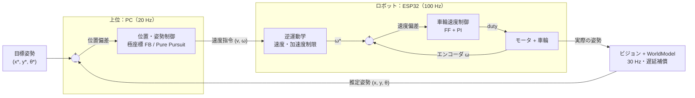
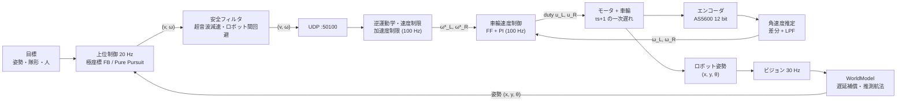
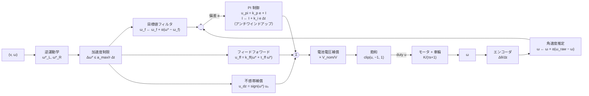
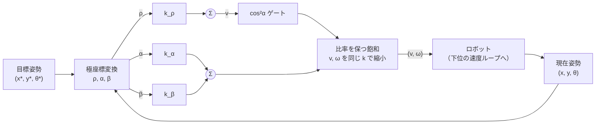
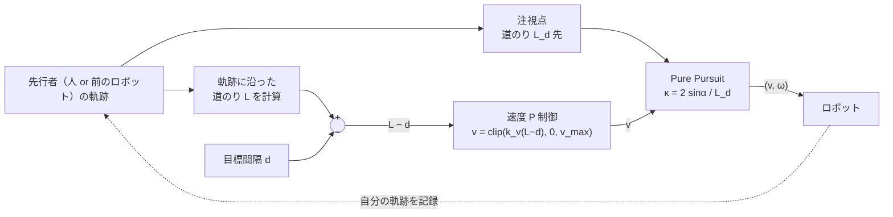
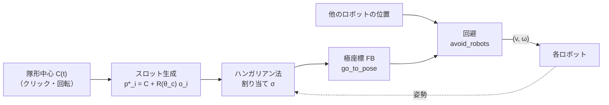
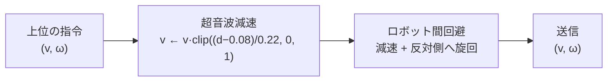

# フィードバック制御則とブロック線図

このページは、COCO-LINK で実際に動いている **フィードバック制御則** を、実装（`pc/src/coco_link/`）と対応させて 1 か所にまとめたものである。
数式の記号は [制御則の解説](control.md) と共通である。

COCO-LINK の制御は、周期の異なる **2 層のカスケード制御** になっている。

| 層 | 場所 | 周期 | 制御するもの | フィードバック信号 | 制御器 |
|---|---|---|---|---|---|
| 下位（車輪速度） | ESP32 / `robot/firmware_model.py` | 100 Hz | 車輪角速度 $\omega_L,\omega_R$ | エンコーダ（AS5600） | モデル逆系 FF + PI + 不感帯・電圧補償 |
| 上位（機体速度） | PC / `control/`, `modes/` | 20 Hz | 機体速度 $(v,\omega)$ | ビジョンの姿勢 $(x,y,\theta)$ | 極座標 FB / Pure Pursuit / P 制御 |
| センサ | ビジョン / `vision/`, `fleet/world_model.py` | 30 Hz | 姿勢の推定 | 天井カメラ + エンコーダ | 遅延補償・推測航法 |

上位が「どこへ行くか」を決め、下位が「その速度を正確に出す」役割を分担している。
上位の 1 周期（50 ms）の間に下位は 5 周期動くため、**内側のループを先に設計し、その応答を「すぐ追従する」とみなして外側を設計する**（時間スケール分離）。

## 1. 全体ブロック線図

### 1.1 カスケード制御の本質（簡易版）

外側の **位置・姿勢ループ** と、内側の **車輪速度ループ** の関係だけを示した図である。
安全フィルタや通信、細かい補償は省略している。

- **外側ループ**：目標姿勢と推定姿勢の差から、速度指令 $(v,\omega)$ を作る
- **内側ループ**：車輪の目標角速度 $\omega^*$ とエンコーダ角速度 $\omega$ の差から、duty を作る
- 内側は外側より 5 倍速いので、外側からは「速度指令どおりに動く」とみなして設計できる

### 1.2 実装の全体像

- **内側のループ**（`WC → PLANT → ENC → EST → WC`）が車輪速度のフィードバック
- **外側のループ**（`UC → … → PLANT → POSE → VIS → WM → UC`）が機体の位置・姿勢のフィードバック
- 上位から下位へは速度指令、下位から上位へはエンコーダ速度（テレメトリ）が流れる

## 2. 下位ループ：車輪速度制御

### 2.1 制御対象（モータ + 車輪）

車輪 1 個あたりのモデルは、一次遅れ + 不感帯 + 電池電圧の影響である（[3 章](study/03_robot_model.md#34-モータのモデル)）。

$$
\tau\,\dot\omega+\omega=K\,u_{\mathrm{eff}}
$$

$$
u_{\mathrm{eff}}=\operatorname{sign}(u)\,\max(|u|-u_0,\ 0)\cdot\frac{V}{V_{\mathrm{nom}}}
$$

伝達関数で書くと

$$
G(s)=\frac{\Omega(s)}{U(s)}=\frac{K}{\tau s+1}
$$

である。$K$: モータゲイン [rad/s/duty]、$\tau$: 時定数 [s]、$u_0$: 不感帯 [duty]、$V/V_{\mathrm{nom}}$: 電池電圧比。

### 2.2 角速度の推定

エンコーダの 12 bit 絶対角をアンラップして累積角 $N_k$ とし、

$$
\theta_k=d_{\mathrm{enc}}\frac{2\pi}{4096}N_k,\qquad
\omega_k^{\mathrm{raw}}=\frac{\theta_k-\theta_{k-1}}{\Delta t}
$$

を得る。量子化による跳びを抑えるため、一次ローパスを通す。

$$
\omega_k=\omega_{k-1}+\alpha\left(\omega_k^{\mathrm{raw}}-\omega_{k-1}\right),\qquad \alpha=0.3
$$

$\alpha=0.3$、$\Delta t=10$ ms のとき、等価な時定数は約 23 ms である。

### 2.3 逆運動学と目標値の制限

機体速度指令 $(v_x,\omega_z)$ から左右の車輪目標角速度を作る。

$$
\omega_L^*=\frac{v_x-\omega_z\,b/2}{r},\qquad
\omega_R^*=\frac{v_x+\omega_z\,b/2}{r}
$$

1. $v_x$ を $\pm v_{\max}$、$\omega_z$ を $\pm\omega_{\max}$ にクランプ
2. どちらかの車輪が $\omega_{\max}=v_{\max}/r$ を超えたら、**両輪を同じ比率で縮小** する（旋回半径を保つ）

$$
k=\min\left(1,\ \frac{\omega_{\max}}{\max(|\omega_L^*|,|\omega_R^*|)}\right),\qquad
\omega_{L,R}^*\leftarrow k\,\omega_{L,R}^*
$$

3. 急発進を防ぐため、目標値の変化率を加速度制限 $a_{\max}$ で制限する

$$
\Delta\omega_{\max}=\frac{a_{\max}}{r}\Delta t,\qquad
\omega_k^*=\omega_{k-1}^*+\operatorname{clip}\left(\omega_{\mathrm{cmd}}^*-\omega_{k-1}^*,\ -\Delta\omega_{\max},\ \Delta\omega_{\max}\right)
$$

$$
\dot\omega_k^*=\frac{\omega_k^*-\omega_{k-1}^*}{\Delta t}
$$

### 2.4 制御式（実装そのまま）

以下は車輪 1 個分である（左右で同じ計算を独立に行う）。

**目標値フィルタ**（速度推定と同じ遅れを目標値にも与える）

$$
\omega_f^{+}=\omega_f+\alpha\left(\omega^*-\omega_f\right)
$$

**偏差**

$$
e=\omega_f^{+}-\omega
$$

**フィードフォワード**（モデル $\tau\dot\omega+\omega=Ku$ の逆系）

$$
u_{ff}=k_{ff}\left(\omega^*+\tau_{ff}\,\dot\omega^*\right),
\qquad k_{ff}=\frac{1}{K},\quad \tau_{ff}=\tau
$$

**不感帯補償**

$$
u_{dz}=
\begin{cases}
\operatorname{sign}(\omega^*)\,u_0 & (|\omega^*|\ge 0.05\ \mathrm{rad/s})\\[2pt]
0 & (|\omega^*|<0.05\ \mathrm{rad/s})
\end{cases}
$$

**PI フィードバック**

$$
u_{pi}=k_p\,e+I
$$

$$
I\leftarrow I+k_i\,e\,\Delta t
\quad\text{ただし}\quad
|u|<1\ \ \text{または}\ \ \operatorname{sign}(u)\ne\operatorname{sign}(e)\ \text{のときだけ}
$$

**合成・電池電圧補償・飽和**

$$
u_{\mathrm{raw}}=u_{ff}+u_{dz}+u_{pi}
$$

$$
u=\operatorname{clip}\left(u_{\mathrm{raw}}\cdot\frac{V_{\mathrm{nom}}}{V},\ -1,\ 1\right)
$$

**停止時の特別扱い**

$$
|\omega^*|<0.05\ \text{かつ}\ |\omega|<0.2
\quad\Longrightarrow\quad
u=0,\quad I=0,\quad \omega_f=0
$$

これは停止時に PI が微小な偏差を積分して「うなり」を出し続けるのを防ぐためである。

### 2.5 2 自由度制御としての解釈

フィードフォワードとフィードバックを合わせた制御器は

$$
u=C(s)\left(\Omega^*(s)-\Omega(s)\right)+F(s)\,\Omega^*(s)
$$

$$
C(s)=k_p+\frac{k_i}{s},\qquad F(s)=k_{ff}\left(1+\tau_{ff}s\right)
$$

と書ける。$C(s)$ が偏差を消すフィードバック、$F(s)$ が「必要な duty を先に出す」フィードフォワードである。
FF があるので PI はモデル誤差・外乱・不感帯の残りだけを直せばよく、応答を速くしてもオーバーシュートしにくい。

システム同定では、同定した $K,\tau$ から **IMC（内部モデル制御）法** でゲインを決める（`sysid/estimators.py::imc_pi`）。

$$
k_p=\frac{\tau}{K\lambda},\qquad
k_i=\frac{1}{K\lambda},\qquad
k_{ff}=\frac{1}{K},\qquad
\tau_{ff}=\tau
$$

このとき PI だけの開ループは

$$
L(s)=C(s)G(s)=\frac{1}{\lambda s}
$$

となり、閉ループは一次遅れになる。

$$
\frac{\Omega(s)}{\Omega^*(s)}=\frac{L(s)}{1+L(s)}=\frac{1}{\lambda s+1}
$$

$\lambda$ は閉ループの時定数（設計パラメータ、既定 0.05 s）で、小さいほど速いが、モデル誤差・遅れ・ノイズに対して厳しくなる。

### 2.6 車輪速度ループのブロック線図

## 3. 上位ループ：姿勢・軌跡のフィードバック

上位は 20 Hz で、WorldModel から得た全ロボットの姿勢を見て、各ロボットの $(v,\omega)$ を決める。

### 3.1 極座標フィードバック（`go_to_pose`）

目標姿勢 $(x^*,y^*,\theta^*)$ までの誤差を、ロボット座標系の極座標 $(\rho,\alpha,\beta)$ で表す。

$$
\Delta x=x^*-x,\qquad \Delta y=y^*-y
$$

$$
\rho=\sqrt{\Delta x^2+\Delta y^2},\qquad
\alpha=\operatorname{wrap}\left(\operatorname{atan2}(\Delta y,\Delta x)-\theta\right),\qquad
\beta=\operatorname{wrap}\left(\theta^*-\theta-\alpha\right)
$$

制御則は

$$
v=k_\rho\,\rho,\qquad
\omega=k_\alpha\,\alpha+k_\beta\,\beta
$$

である。$k_\rho>0,\ k_\beta<0,\ k_\alpha-k_\rho>0$ のとき、目標姿勢は局所漸近安定である（Siegwart ら）。
実装では次の修正を加えている。

**後退の許可**（$|\alpha|>\pi/2$ のとき U ターンせずバックする）

$$
\alpha\leftarrow\operatorname{wrap}(\alpha+\pi),\qquad v\leftarrow-v
$$

**前進の抑止**（目標方向を向くまで進まない）

$$
v\leftarrow v\,\max(0,\cos\alpha)^2
$$

**曲率を保つ飽和**（$v$ と $\omega$ を同じ比率で縮める）

$$
k=\min\left(1,\frac{v_{\max}}{|v|},\frac{\omega_{\max}}{|\omega|}\right),\qquad
(v,\omega)\leftarrow(kv,k\omega)
$$

**到着後の向き合わせ**（$\rho<$ 3 cm のとき）

$$
v=0,\qquad
\omega=\operatorname{clip}\left(k_{\mathrm{heading}}\,\operatorname{wrap}(\theta^*-\theta),\ -\omega_{\max},\ \omega_{\max}\right)
$$

### 3.2 Kanayama の軌道追従則（`kanayama_tracking`）

参照軌道が $(v_r,\omega_r)$ で動いているとき、ロボット座標系での誤差を $(e_x,e_y,e_\theta)$ とすると

$$
v=v_r\cos e_\theta+k_x e_x
$$

$$
\omega=\omega_r+v_r\left(k_y e_y+k_\theta\sin e_\theta\right)
$$

である。Lyapunov 関数で大域的安定性が示されている（Kanayama et al., 1990）。
現在は「経路計画して走行」モードの候補として実装されている。

### 3.3 Pure Pursuit（`pure_pursuit`）

軌跡上で、自分から道のり $L_d$（注視距離）だけ先の点を目標にする。
注視点の方向を $\alpha$、距離を $L_d$ とすると、その点を通る円弧の曲率は

$$
\kappa=\frac{2\sin\alpha}{L_d}
$$

なので、角速度は

$$
\omega=v\,\kappa=\frac{2v\sin\alpha}{L_d}
$$

となる。注視点が真後ろ（$|\alpha|>\pi/2$）のときは前進せず、その場で向きを変える。

### 3.4 人追従（隊列）のカスケード

先頭は人の軌跡を、後続は前のロボットの軌跡を、道のりで一定間隔を保って追う（[4 章](control.md#4-人追従隊列modesfollow_personpy-controlpath_followpy)）。

**速度：道のり誤差の P 制御**

$$
L=\text{自分から先行者までの軌跡に沿った道のり},\qquad d=\text{目標間隔}
$$

$$
v=\operatorname{clip}\left(k_v(L-d),\ 0,\ v_{\max}\right)
$$

**操舵：Pure Pursuit**

$$
\omega=v\,\kappa,\qquad \kappa=\frac{2\sin\alpha}{L_d}
$$

道のりを使うため、カーブで内側をショートカットしない。

### 3.5 フォーメーション（仮想構造 + 割り当て + 回避）

隊形全体を 1 つの剛体（仮想構造）とみなし、中心姿勢 $C=(x_c,y_c,\theta_c)$ と隊形座標でのスロット位置 $o_i$ から目標を作る。

$$
p_i^*=\begin{bmatrix}x_c\\y_c\end{bmatrix}+R(\theta_c)\,o_i,\qquad \theta_i^*=\theta_c
$$

ロボット $i$ をスロット $\sigma(i)$ に割り当てる問題は、二乗距離の和を最小化する組合せ最適化である。

$$
\min_{\sigma}\sum_i\left\lVert p_i-p_{\sigma(i)}^*\right\rVert^2
$$

ハンガリアン法（`scipy.optimize.linear_sum_assignment`）で $O(n^3)$ で解く。
割り当てはロボット集合・隊形が変わったときだけ更新する（毎周期変えると振動する）。

各ロボットは自分のスロットへ 3.1 の極座標 FB で向かい、近くのロボットを簡易ポテンシャル法で避ける。

### 3.6 安全フィルタ（飽和・ポテンシャル）

上位で計算した指令は、送信前に安全フィルタを通る（`control/safety.py`）。

**超音波による減速**：進行方向の距離 $d$ に対して

$$
v\leftarrow v\cdot\operatorname{clip}\left(\frac{d-d_{\mathrm{stop}}}{d_{\mathrm{slow}}-d_{\mathrm{stop}}},\ 0,\ 1\right)
$$

$$
d_{\mathrm{stop}}=0.08\ \mathrm{m},\qquad d_{\mathrm{slow}}=0.30\ \mathrm{m}
$$

**ロボット間の回避**：前方 $\pm60^\circ$・影響半径 $r_{\mathrm{inf}}=0.25$ m 以内の他ロボット $j$ に対し

$$
d_j=\lVert p_j-p\rVert-2r_{\mathrm{body}},\qquad
k_j=\operatorname{clip}\left(\frac{d_j}{r_{\mathrm{inf}}},\ 0,\ 1\right)
$$

$$
v\leftarrow v\cdot\min_j k_j,\qquad
\omega\leftarrow\omega+\sum_j\left[-\operatorname{sign}\left(k_{\mathrm{turn}}(1-k_j),\ \beta_j\right)\right]
$$

$\beta_j$ は相手の方位角である。近いほど強く減速し、相手と反対側へ旋回する。

## 4. 遅延補償（フィードバックを支える推定）

ビジョンの姿勢は 50–100 ms 遅れて届く。その間に進んだ分を、エンコーダから求めた $(v,\omega)$ で外挿する（`fleet/world_model.py`）。

観測姿勢 $(x_0,y_0,\theta_0)$ と経過時間 $\Delta t$ に対し、$|\omega|$ が十分小さいときは直進、

$$
x=x_0+v\Delta t\cos\theta_0,\qquad
y=y_0+v\Delta t\sin\theta_0,\qquad
\theta=\theta_0
$$

それ以外は円弧で積分する。

$$
\theta_2=\theta_0+\omega\Delta t,\qquad
R=\frac{v}{\omega}
$$

$$
x=x_0+R\left(\sin\theta_2-\sin\theta_0\right),\qquad
y=y_0-R\left(\cos\theta_2-\cos\theta_0\right),\qquad
\theta=\theta_2
$$

これはフィードバック信号そのものではなく、**古い観測を現在時刻に合わせる予測器** である。
ビジョンが 0.5 s 以上途切れたら「姿勢不明」として制御対象から外す（安全側）。

## 5. ゲイン・パラメータ一覧

| 記号 | 意味 | 既定値・公称値 | 定義場所 |
|---|---|---|---|
| $\alpha$ | 角速度推定・目標値フィルタの LPF 係数 | 0.3（時定数 約 23 ms） | `firmware_model.py` |
| $K$ | モータゲイン | 25 rad/s/duty | `config/robots/default.yaml` |
| $\tau$ | モータ時定数 | 0.060 s | 同上 |
| $u_0$ | 不感帯 | 0.10 duty | 同上 |
| $k_p$ | 車輪速度 PI の比例ゲイン | 0.02（既定） | `firmware_model.py` |
| $k_i$ | 車輪速度 PI の積分ゲイン | 0.4（既定） | 同上 |
| $k_{ff}$ | フィードフォワードゲイン | 0.04（= $1/K$） | 同上 |
| $\tau_{ff}$ | フィードフォワード時定数 | 0.06 s（= $\tau$） | 同上 |
| $\lambda$ | IMC の閉ループ時定数 | 0.05 s | `sysid/experiments.py` |
| $k_\rho,k_\alpha,k_\beta$ | 極座標 FB のゲイン | 1.2, 4.0, −0.8 | `control/pose_tracking.py` |
| $k_{\mathrm{heading}}$ | 到着後の向き合わせゲイン | 3.0 | 同上 |
| $k_v$ | 人追従の速度ゲイン | 1.5 1/s | `modes/follow_person.py` |
| $L_d$ | Pure Pursuit の注視距離 | 0.12 m | 同上 |
| $d_{\mathrm{stop}},d_{\mathrm{slow}}$ | 超音波の停止・減速距離 | 0.08, 0.30 m | `control/safety.py` |

既定の $k_p,k_i$ は控えめな値であり、システム同定を実行すると $\lambda$ と同定した $K,\tau$ から計算した値がロボットに書き込まれる（`set_param`）。

## 6. 設計上の要点

1. **カスケードと時間スケール分離**：下位 100 Hz・上位 20 Hz。外側は「内側は指令どおりの速度をすぐ出せる」とみなして設計する。
2. **2 自由度制御（FF + FB）**：モデルの逆系で必要な入力を先に与え、PI は残差だけを直す。車輪速度でも Pure Pursuit でも「曲率」という形で FF を使っている。
3. **目標値フィルタ**：計測値と同じローパスを目標値にも通し、加速中の偽の偏差によるオーバーシュートを抑える。
4. **飽和とアンチワインドアップ**：duty は $\pm1$、$(v,\omega)$ は上限、超音波・回避でも飽和させる。飽和中は積分を止める。
5. **安全側に倒す**：通信が切れればロボット側のウォッチドッグが止め、ビジョンが途切れれば推測航法を 0.5 s で打ち切る。

## 7. 対応するコード

| 内容 | 場所 |
|---|---|
| 車輪速度 FF + PI・エンコーダ推定・状態機械 | [`pc/src/coco_link/robot/firmware_model.py`](https://github.com/banbatakumi/COCO-LINK/blob/main/pc/src/coco_link/robot/firmware_model.py) |
| モータの物理モデル | [`pc/src/coco_link/robot/plant.py`](https://github.com/banbatakumi/COCO-LINK/blob/main/pc/src/coco_link/robot/plant.py) |
| 逆運動学・速度制限・円弧積分 | [`pc/src/coco_link/robot/kinematics.py`](https://github.com/banbatakumi/COCO-LINK/blob/main/pc/src/coco_link/robot/kinematics.py) |
| 極座標 FB・Kanayama | [`pc/src/coco_link/control/pose_tracking.py`](https://github.com/banbatakumi/COCO-LINK/blob/main/pc/src/coco_link/control/pose_tracking.py) |
| Pure Pursuit・軌跡記録 | [`pc/src/coco_link/control/path_follow.py`](https://github.com/banbatakumi/COCO-LINK/blob/main/pc/src/coco_link/control/path_follow.py) |
| 隊形生成・ハンガリアン法 | [`pc/src/coco_link/control/formation.py`](https://github.com/banbatakumi/COCO-LINK/blob/main/pc/src/coco_link/control/formation.py) |
| 超音波減速・回避 | [`pc/src/coco_link/control/safety.py`](https://github.com/banbatakumi/COCO-LINK/blob/main/pc/src/coco_link/control/safety.py) |
| 上位モード（隊形・人追従） | [`pc/src/coco_link/modes/`](https://github.com/banbatakumi/COCO-LINK/tree/main/pc/src/coco_link/modes) |
| 遅延補償・推測航法 | [`pc/src/coco_link/fleet/world_model.py`](https://github.com/banbatakumi/COCO-LINK/blob/main/pc/src/coco_link/fleet/world_model.py) |
| IMC によるゲイン計算 | [`pc/src/coco_link/sysid/estimators.py`](https://github.com/banbatakumi/COCO-LINK/blob/main/pc/src/coco_link/sysid/estimators.py) |

## 参考文献

1. R. Siegwart, I. Nourbakhsh, D. Scaramuzza, *Introduction to Autonomous Mobile Robots*, 2nd ed., MIT Press, 2011.
2. Y. Kanayama et al., "A stable tracking control method for an autonomous mobile robot," ICRA, 1990.
3. R. C. Coulter, "Implementation of the Pure Pursuit Path Tracking Algorithm," CMU-RI-TR-92-01, 1992.
4. M. Morari, E. Zafiriou, *Robust Process Control*, Prentice Hall, 1989.（IMC）
