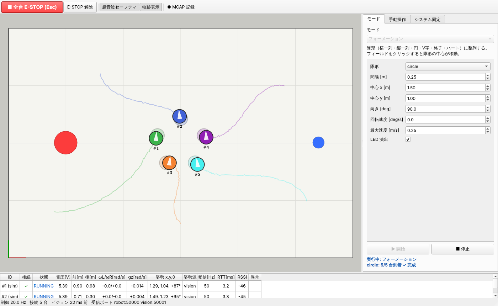

# COCO-LINK

**避難所・介護施設で、複数台のロボットが協調するパフォーマンスで人々を楽しませ、心のケアをしながら物資の運搬も担う
実用型パフォーマンスロボットシステム**（立命館大学 理工学部 ロボティクス学科「ロボット創造実験」）

## このサイトの使い方

- :material-school: **[学習資料](study/index.md)**

    班員全員がシステムの中身と使っている技術を説明できるようになるための資料。
    制御の基礎用語の復習から、口頭試問の想定問答集まで。**まずはここから。**

- :material-file-document: **設計文書**

    開発者向けの技術リファレンス。[アーキテクチャ](architecture.md)・[通信プロトコル](protocol.md)・
    [ファームウェア仕様書](firmware_spec.md)・[制御則](control.md) など。

## ソースコード

[github.com/banbatakumi/COCO-LINK](https://github.com/banbatakumi/COCO-LINK)
（起動方法はリポジトリの README を参照）
