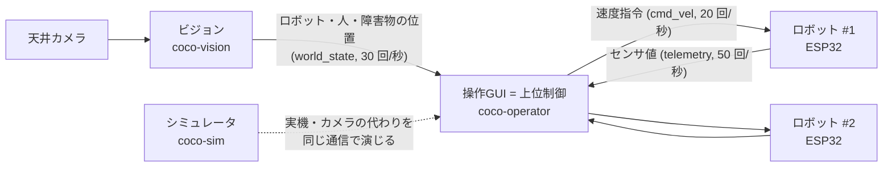
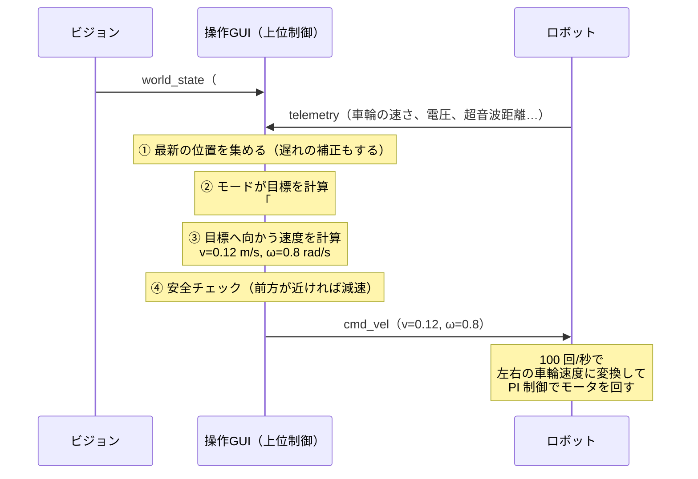

# 1. 全体像：何を作ったのか

!!! tip "ひとことで"
    **カメラで全ロボットの位置を見て、PC が「どこへ行くか」を考え、各ロボットに「この速さで進め」と無線で伝える。
    ロボットは自分の車輪をその速さで回す。** これを 1 秒に 20 回くり返す。

## 1.1 登場人物

| 登場人物 | 役割 | たとえ |
|---|---|---|
| **ロボット**（ESP32） | 2 輪で走る。前後の超音波センサ・IMU（加速度・角速度）・エンコーダ（車輪の回転角）・LED・ブザーを持つ。言われた速さで車輪を回す（**下位制御**） | 体と脊髄反射 |
| **ビジョン** | 天井カメラの映像から、ロボットの位置・向き（ArUco マーカー）と、人（緑）・障害物（赤）・物資（青）の位置を測る | 目 |
| **操作GUI（上位制御）** | 全体を見て「誰がどこへどう動くか」を決める。モード（フォーメーション・人追従）、手動操作、システム同定、ログ記録 | 脳 |
| **シミュレータ** | 実機がなくても開発できるよう、**ロボットとカメラのふりをする**。物理法則で仮想ロボットを動かし、実機と同じ通信をする | 練習用のダミー |

!!! note "上位制御と下位制御"
    - **下位制御**（ロボットの中、1 秒に 100 回）: 「車輪を毎秒 7 rad で回せ」を実現する。モータの電圧を細かく調整する
    - **上位制御**（PC、1 秒に 20 回）: 「ロボット #3 は 0.15 m/s で前進しつつ左に曲がれ」を決める。全体の位置関係を見て判断する

    速く細かい制御はロボット側、全体を見る判断は PC 側、と **役割を階層に分ける** のは、ロボット制御の基本的な設計です。

## 1.2 なぜ「シミュレータが実機と同じ通信をする」ことが大事か

普通は「シミュレータ用のプログラム」と「実機用のプログラム」を別々に作りがちですが、COCO-LINK では
**操作GUIから見ると、相手がシミュレータか実機か区別がつかない** ように作りました。

- シミュレータは「仮想 ESP32 を N 台」と「仮想カメラ」を演じ、**実機とまったく同じ形式のメッセージ** を送受信する
- だから、シミュレータで動いたフォーメーションやシステム同定は、**プログラムを 1 行も変えずに** 実機で動く
- 実機がまだ完成していなくても、上位制御の開発とテストを進められる

さらにシミュレータの仮想ロボットには、**わざと 1 台ずつ違う特性（個体差）** を持たせています。
現実のロボットも「同じ部品で作ったのに 1 台ずつ速さが違う」ので、それを再現し、システム同定で見抜けるかを確かめられます。

## 1.3 制御 1 周期で何が起きるか（フォーメーションの例）

1 秒に 20 回、つまり **50 ms ごと** に次のことが起きています。

1. **状態を集める**: ビジョンからの位置と、ロボットからのセンサ値をまとめて「世界の様子（World）」を作る。
   カメラの画像は 50〜100 ms 遅れて届くので、その間に進んだ分を車輪の回転から推定して補正する（[5 章](05_upper_control.md#56-カメラの遅れを補う遅延補償と推測航法)）
2. **モードが目標を決める**: フォーメーションなら「円の 5 か所のうち、どこに誰が行くか」と各ロボットの目標位置
3. **目標へ向かう速度を計算**: 2 輪ロボットは横に動けないので、向きを変えながら近づく速度 $(v, \omega)$ を計算
4. **安全チェックと優先順位**: 超音波で前が近ければ減速。E-STOP（非常停止）や手動操作が優先される
5. **送信**: 各ロボットに `cmd_vel`（速度指令）を UDP で送る
6. **ロボット側**: 受け取った $(v, \omega)$ を左右の車輪の角速度に変換し、エンコーダで測った実際の速さとの差を
   **PI 制御** で埋めるようにモータの PWM を決める（[3 章](03_robot_model.md)）

## 1.4 用意してある動作（モード）

| モード | 内容 | 主な技術 |
|---|---|---|
| フォーメーション | 円・V 字・横一列・ハートなどに整列。フィールドをクリックすると隊形が移動、回転もできる | 仮想構造法、ハンガリアン法、極座標フィードバック |
| 人追従（隊列） | 緑の服を着た人の後ろに一列に並んでついていく | 軌跡（パンくず）追従、Pure Pursuit |
| 手動操作 | キーボードで 1 台を走らせる。LED・ブザー・パラメータ変更 | （動作試験用） |
| システム同定 | 決まった動作をさせ、モータ・車輪の特性を測ってゲインを決める | 最小二乗法、IMC 法 |

モードは **ファイルを 1 つ追加するだけで増やせる** 作り（プラグイン）になっていて、今後「協調物資運搬」「経路計画走行」を追加する予定です。

## 1.5 現在の到達点（正直に把握しておく）

| 項目 | 状態 |
|---|---|
| 操作GUI・シミュレータ・ビジョン | 動作する。自動テスト 127 件（Mac/Windows/Linux） |
| フォーメーション・人追従・システム同定 | **シミュレータ上で** 動作を確認済み |
| ビジョン | **合成画像** で精度を確認（位置 1 cm 以内、向き 3° 以内）。実カメラは未検証 |
| ロボットのファームウェア（ESP32） | **仕様書のみ**（`docs/firmware_spec.md`）。実装はこれから |
| 実機での検証 | これから |

!!! warning "口頭試問での言い方"
    「実機で動きました」とは言わないこと。**「シミュレータ上で、実機と同じ通信・同じ制御則で確認しました。
    実機ではファームウェアを仕様書どおりに作れば、上位側はそのまま動く設計です」** が正確です。

## 対応するコード・文書

| 内容 | 場所 |
|---|---|
| 全体の設計 | [設計文書: アーキテクチャ](../architecture.md) |
| 制御 1 周期の処理 | [`pc/src/coco_link/fleet/control_core.py`](https://github.com/banbatakumi/COCO-LINK/blob/main/pc/src/coco_link/fleet/control_core.py) の `tick()` |
| 通信の決まり | [設計文書: 通信プロトコル](../protocol.md) |
| シミュレータ | [`pc/src/coco_link/sim/`](https://github.com/banbatakumi/COCO-LINK/tree/main/pc/src/coco_link/sim) |
