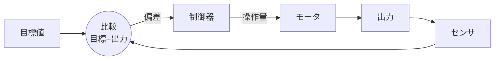
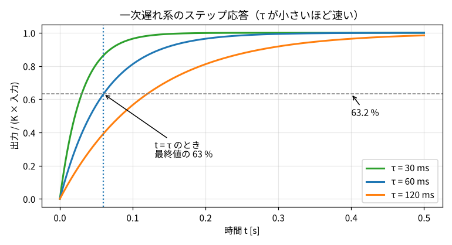
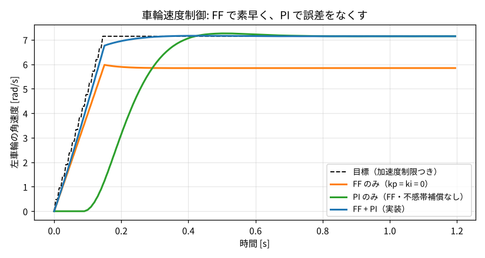
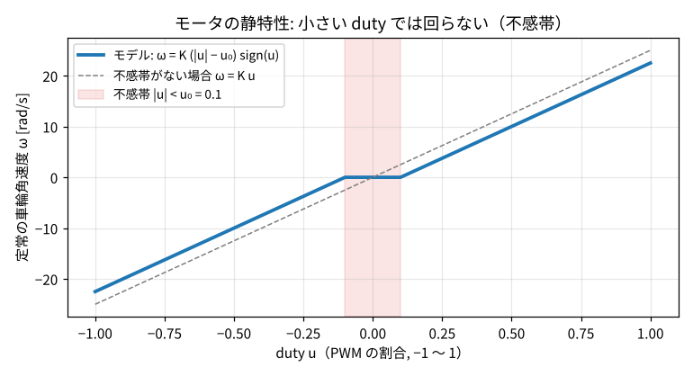
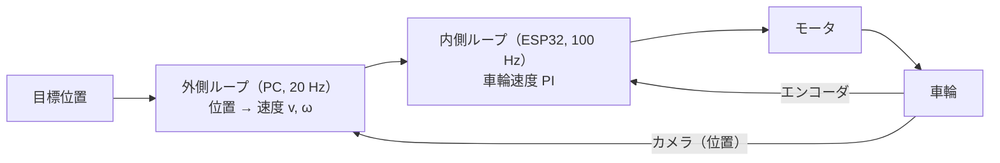

# 2. 制御の基礎の復習

授業で習った制御工学の言葉を、**COCO-LINK のロボットの車輪** を例にして復習します。
ここが分かると、3 章以降がぐっと読みやすくなります。

## 2.1 制御とは：言葉の整理

!!! tip "ひとことで"
    **制御** とは、思いどおりの状態にするために、入力を自動で調整し続けること。

車輪を「毎秒 7 rad で回したい」場面で考えます。

| 用語 | 意味 | 車輪の例 |
|---|---|---|
| **制御対象**（プラント） | 制御したいもの | モータ＋車輪 |
| **目標値**（指令値, 参照値 $r$） | こうなってほしい値 | 7 rad/s |
| **制御量**（出力 $y$） | 実際の値（センサで測る） | エンコーダで測った車輪の角速度 |
| **操作量**（入力 $u$） | こちらが変えられるもの | モータに加える PWM の duty（−1〜1） |
| **偏差** $e = r - y$ | 目標と実際の差 | 7 − 6.5 = 0.5 rad/s |
| **外乱** $d$ | 勝手に入ってくる邪魔 | 床の摩擦、坂、電池電圧の低下、人がロボットを押す |
| **制御器**（コントローラ） | 偏差などから操作量を決める計算 | PI 制御のプログラム |

## 2.2 開ループ制御とフィードバック制御

**開ループ制御**（測らない）

**フィードバック制御**（閉ループ: 出力を測って戻す）

- **開ループ制御**: 「7 rad/s なら duty 0.38」と決め打ちで出す。測らないので、電池が減ったり摩擦が変わったりすると **ずれたまま気づかない**
- **フィードバック制御**（閉ループ）: センサで実際の値を測り、**目標との差（偏差）を見て操作量を直し続ける**。外乱や個体差に強い。
  ただし、ずれが起きてから直すので **反応が少し遅れる**。また、強く直しすぎると **振動・不安定** になることがある

COCO-LINK では両方を組み合わせています（[2.7 フィードフォワード](#27-フィードフォワードと-2-自由度制御)）。

## 2.3 モデルと伝達関数

### なぜモデルが必要か

「どのくらい強く直せばよいか（ゲイン）」を勘で決めると、遅すぎたり振動したりします。
**制御対象の性質を式で表したもの（モデル）** があれば、ゲインを理論的に決められます。

### モータの微分方程式

モータに duty $u$ を加えたとき、車輪の角速度 $\omega$ は **すぐには** 最終値にならず、だんだん近づきます（慣性があるため）。これを

$$
\tau \frac{d\omega}{dt} + \omega = K u
$$

と表します。$K$ と $\tau$ はモータごとの定数です。

### ラプラス変換と伝達関数（直感）

**ラプラス変換** は、微分方程式を **掛け算・割り算の式** に変える道具です。「$\frac{d}{dt}$ を $s$ に置き換える」と覚えれば十分です。
上の式は

$$
\tau s\,\Omega(s) + \Omega(s) = K U(s)
\quad\Longrightarrow\quad
G(s) = \frac{\Omega(s)}{U(s)} = \frac{K}{\tau s + 1}
$$

この **出力 ÷ 入力** の比 $G(s)$ を **伝達関数** といいます。ブロック線図の箱の中に書く「その要素の性質」です。
$\frac{K}{\tau s+1}$ の形を **一次遅れ系** と呼びます。

## 2.4 一次遅れ系：ゲイン K と時定数 τ

duty を 0 から $u_0$ へ一気に変える（**ステップ入力**）と、角速度は

$$
\omega(t) = K u_0 \left(1 - e^{-t/\tau}\right)
$$

と変化します（**ステップ応答**）。

| パラメータ | 意味 | 見分け方 |
|---|---|---|
| **ゲイン $K$** | 最終的にどれだけ出るか（定常ゲイン）。COCO-LINK では「duty 1 あたり何 rad/s」 | 十分時間がたった後の値 ÷ 入力 |
| **時定数 $\tau$** | どれだけ速く反応するか。小さいほど速い | **最終値の 63.2 % に達するまでの時間**（$1-e^{-1}=0.632$） |

目安として、$3\tau$ で 95 %、$5\tau$ で 99 % に達します。
COCO-LINK のモータの公称値は $K = 25$ rad/s/duty、$\tau = 60$ ms です（具体的な部品が未定のための **仮の値**。実機ができたら [システム同定](04_system_identification.md) で測る）。

## 2.5 ステップ応答の評価指標

制御がうまくいっているかは、目標をステップ状に変えたときの応答で評価します。

| 指標 | 意味 | 望ましい |
|---|---|---|
| **立ち上がり時間** | 最終値の 10 % → 90 % にかかる時間 | 短い |
| **オーバーシュート** | 目標を行き過ぎた量（%） | 小さい（0〜5 %） |
| **整定時間** | 目標の ±2〜5 % に収まるまでの時間 | 短い |
| **定常偏差** | 十分時間がたっても残る誤差 | 0 |

COCO-LINK のシステム同定の最後の試験「検証（速度ステップ）」は、まさにこれを測っています。

## 2.6 PID 制御

最も広く使われるフィードバック制御です。偏差 $e(t)$ から操作量を

$$
u(t) = \underbrace{K_P\,e(t)}_{\text{P: 今}} + \underbrace{K_I \int_0^t e\,dt}_{\text{I: 過去}} + \underbrace{K_D \frac{de}{dt}}_{\text{D: 未来}}
$$

で決めます。

| 項 | 役割 | たとえ（車の運転） | 副作用 |
|---|---|---|---|
| **P（比例）** | 今の誤差に比例して直す | 目標速度から遠いほど強くアクセル | P だけだと **定常偏差が残る**。大きすぎると振動 |
| **I（積分）** | 誤差の積み重ねで直す。**定常偏差を 0 にする** | 「ずっと少し遅い」なら少しずつアクセルを足す | 反応が遅い、行き過ぎ（オーバーシュート）、ワインドアップ |
| **D（微分）** | 誤差の変化の速さで直す。振動を抑える | 速度が急に上がっているなら早めに緩める | **ノイズを増幅する** |

### COCO-LINK では PI 制御（D なし）

- モータは一次遅れ系なので、**PI だけで十分に速く・安定に** できる（IMC 法で設計, [4 章](04_system_identification.md#48-同定結果から制御器を設計するimc-法)）
- エンコーダは 1 周 4096 分割で、角速度を差分で求めると細かいガタガタ（量子化ノイズ）が乗る。**D 項はこれを増幅** してしまう

!!! question "なぜ P だけだと定常偏差が残るの？"
    車輪を 7 rad/s で回し続けるには、ずっと duty ≈ 0.38 を出し続ける必要があります。
    P 制御は「誤差 × $K_P$」しか出さないので、duty 0.38 を出すには **誤差が 0.38/$K_P$ だけ残っている必要がある**。
    I 項は誤差を積算して「出し続けるべき duty」を覚えるので、誤差 0 のまま duty 0.38 を出せます。

## 2.7 フィードフォワードと 2 自由度制御

**フィードフォワード（FF）** は、**モデルを使って「必要な操作量」を先回りして計算** する方法です。
「7 rad/s 出したいなら、$\omega = Ku$ より $u = 7/K$」と、測る前に出してしまいます。

- FF は **速い**（誤差が出るのを待たない）が、**モデルがずれていると誤差が残る**
- フィードバック（FB）は **遅い** が、モデルのずれや外乱も **最終的には直す**

そこで、**FF で大部分を出し、残りのずれを FB（PI）で直す** のが **2 自由度制御** です。
「目標への追従」と「外乱への強さ」を別々に設計できるので、2 自由度と呼びます。

COCO-LINK のロボットの車輪制御は（[3 章](03_robot_model.md#35-ロボットの中の車輪速度制御)）:

$$
u = \underbrace{k_{ff}\left(\omega^* + \tau_{ff}\,\dot\omega^*\right)}_{\text{FF: モデルの逆}} + \underbrace{u_{dz}}_{\text{不感帯補償}} + \underbrace{k_p e + \int k_i e\,dt}_{\text{FB: PI}}
$$

$\omega = K u$ だけでなく慣性（$\tau$）の分まで逆算しているのがポイントで、**モデルの逆（逆モデル）** と呼びます。

上の図は、ロボットの真のゲインを公称値より 15 % 小さくした（＝モデルがずれている）状態でのシミュレーションです。

- **FF のみ**（橙）: 速く立ち上がるが、モデルのずれのぶん目標に届かない（定常偏差）
- **PI のみ**（緑）: 不感帯を越えるまで動き出せず遅れ、行き過ぎ（オーバーシュート）もある
- **FF + PI**（青, 実装）: 目標にぴったり追従し、ずれも PI が直す

## 2.8 非線形性：飽和と不感帯

現実のモータは $\omega = Ku$ の比例関係だけではありません。

- **飽和**: duty は −1〜1 以上出せない。速度にも上限がある
- **不感帯**: duty が小さい（$|u| < u_0$）と、摩擦に負けて **回らない**。COCO-LINK の公称値は $u_0 = 0.10$

対策:

- **不感帯補償**: 動かしたいときは、あらかじめ $u_0$ を足しておく（上式の $u_{dz}$）
- **アンチワインドアップ**（次節）

## 2.9 積分ワインドアップとアンチワインドアップ

duty が上限 1 に張り付いている（飽和）と、いくら I 項を大きくしても実際の出力は増えません。
それでも誤差は残るので、**I 項が積み上がり続けます**（**ワインドアップ**）。
目標に近づいたとき、溜まった I 項がなかなか減らず、大きく **行き過ぎ** ます。

**アンチワインドアップ**: 出力が飽和している間は（誤差がさらに飽和を強める向きなら）積分を止める。COCO-LINK のファームはこれを行います。

## 2.10 ローパスフィルタ

センサの値はガタガタ（ノイズ）しています。**ローパスフィルタ（LPF）** は、ゆっくりした変化だけを通して細かい揺れを取り除きます。
プログラムでは 1 行で書けます（**一次ローパス** / 指数移動平均）:

$$
y_k = y_{k-1} + \alpha\,(x_k - y_{k-1})\qquad(0<\alpha\le 1)
$$

- $\alpha$ が小さいほど滑らかになるが、**遅れる**
- COCO-LINK のロボットは車輪の角速度を $\alpha = 0.3$、100 Hz で平滑化しており、遅れは約 **23 ms**（$T_s(1-\alpha)/\alpha$）

!!! warning "フィルタの遅れには副作用がある"
    この 23 ms の遅れのせいで、加速中に「実際より遅く回っている」と勘違いした PI が押し過ぎ、
    約 15 % のオーバーシュートが出ていました。**目標値にも同じフィルタを通して遅れを揃える** ことで約 3 % まで減らしました
    （[3 章](03_robot_model.md#35-ロボットの中の車輪速度制御)）。実験で見つけて直した工夫として説明できるポイントです。

## 2.11 サンプリングと離散化

コンピュータは連続的には計算できないので、一定の間隔（**サンプリング周期** $T_s$）で「測る → 計算する → 出す」をくり返します（**ディジタル制御**）。

- COCO-LINK: ロボットの車輪制御は **100 Hz（$T_s$ = 10 ms）**、上位制御は **20 Hz（50 ms）**、カメラは 30 Hz
- 出力は次の計算まで同じ値を保つ。これを **零次ホールド（ZOH）** という
- 一次遅れ系をサンプリング周期 $T_s$ で離散化すると

$$
\omega_{k+1} = a\,\omega_k + (1-a)K u_k,\qquad a = e^{-T_s/\tau}
$$

この「次の値 = 今の値 × $a$ + 入力 × $b$」という形は、[システム同定](04_system_identification.md) の **ARX モデル** そのものです。

!!! note "サンプリングはどれくらい速ければよい？"
    制御対象の速さ（時定数）より十分速く測る必要があります。モータの $\tau \approx 60$ ms に対して 10 ms 周期なら、
    1 時定数の間に 6 回測れます。

## 2.12 安定性と「遅れ」

フィードバックで強く直しすぎると、行き過ぎ → 戻しすぎ → … と **振動** し、最悪の場合どんどん大きくなります（**不安定**）。
伝達関数の分母 = 0 の解（**極**）が複素平面の左半分にあれば安定、という判定法を授業で習ったはずです。

直感的に大事なのは、**ループの中に遅れ（むだ時間）があると不安定になりやすい** ことです。

!!! question "なぜ車輪の速度制御を PC ではなくロボット（ESP32）でやるの？"
    Wi-Fi の通信には数 ms〜数十 ms の遅れとばらつきがあります。車輪速度のように速い制御をその遅れを含むループで回すと、
    不安定になりやすい。そこで **速い制御はロボットの中（遅れほぼ 0, 100 Hz）**、
    **遅い判断は PC（20 Hz）** と分けています。これを **カスケード（多重ループ）制御** と呼びます。
    内側のループは外側より 5〜10 倍速くするのが目安です。

## 2.13 この章のまとめ（口頭試問で言えるように）

- **フィードバック** は測って直す。外乱に強いが遅れる。**フィードフォワード** はモデルから先回り。速いがモデル誤差に弱い。両方使うのが **2 自由度制御**
- モータは **一次遅れ系** $K/(\tau s+1)$。$K$ は最終的な大きさ、$\tau$ は 63 % に達する時間
- **PI 制御**: P は今の誤差、I は定常偏差を消す。D はノイズを増幅するので使っていない
- **不感帯・飽和** という非線形性があり、**不感帯補償** と **アンチワインドアップ** で対処
- 速い制御はロボット内、遅い判断は PC の **カスケード制御**。通信の遅れを内側ループに入れないため

## 対応するコード・文書

| 内容 | 場所 |
|---|---|
| 車輪速度制御（PI + FF + 不感帯補償 + アンチワインドアップ） | [`pc/src/coco_link/robot/firmware_model.py`](https://github.com/banbatakumi/COCO-LINK/blob/main/pc/src/coco_link/robot/firmware_model.py) の `WheelController` |
| モータの物理モデル（シミュレータ） | [`pc/src/coco_link/robot/plant.py`](https://github.com/banbatakumi/COCO-LINK/blob/main/pc/src/coco_link/robot/plant.py) |
| ファームの制御仕様 | [ファームウェア仕様書 §5](../firmware_spec.md#5-走行制御) |
