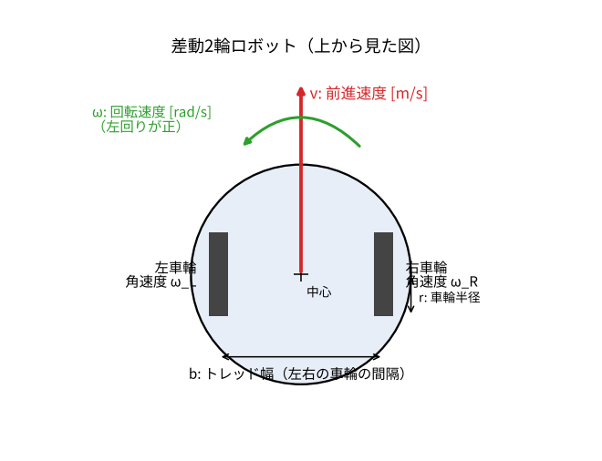
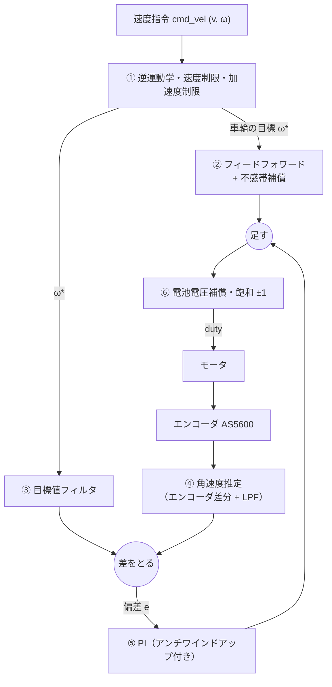
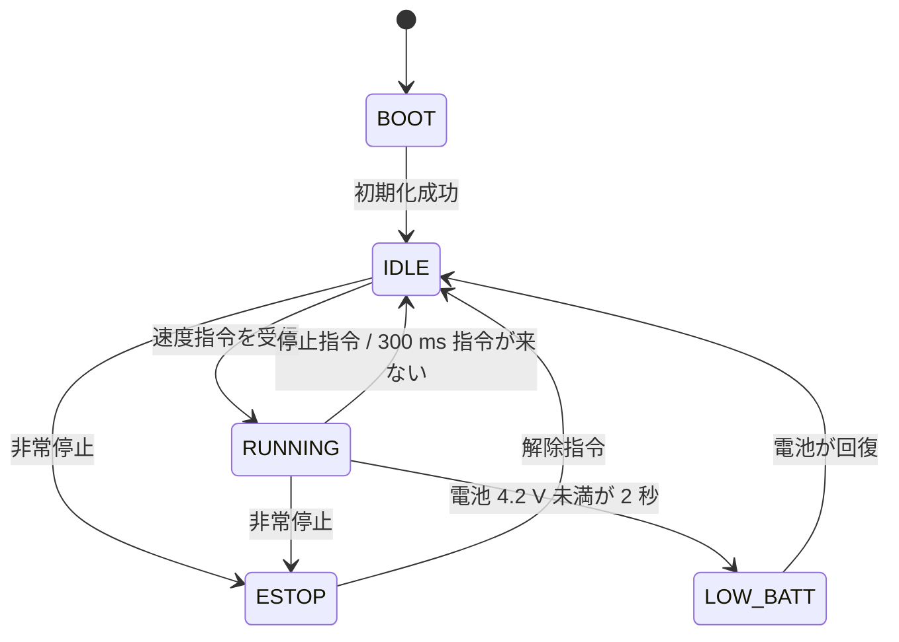

# 3. ロボットのモデルと車輪速度制御

この章では、1 台のロボットが「$v$ で進み $\omega$ で曲がれ」という指令をどうやって実現するかを説明します。

## 3.1 差動 2 輪ロボット

!!! tip "ひとことで"
    左右 2 つの車輪の **回転の速さの差** で曲がるロボット。同じ速さなら直進、差があれば曲がる、逆回転ならその場で回る。

| 記号 | 意味 | COCO-LINK の公称値（仮） |
|---|---|---|
| $r$ | 車輪半径 | 21 mm |
| $b$ | トレッド幅（左右の車輪の間隔） | 90 mm |
| $\omega_L, \omega_R$ | 左右の車輪の角速度 [rad/s] | |
| $v$ | ロボットの前進速度 [m/s] | 最大 0.40 m/s |
| $\omega$ | ロボットの回転速度（左回りが正）[rad/s] | 最大 4.0 rad/s |
| $(x, y, \theta)$ | フィールド上の位置と向き（**姿勢**） | |

## 3.2 運動学：車輪の速さとロボットの動きの関係

**運動学** とは、力を考えずに「速度と位置の関係」だけを扱うことです。

### 順運動学（車輪 → ロボット）

車輪の接地点の速さは $r\omega$ です。ロボットの中心の速さは左右の平均、回転は左右の差をトレッド幅で割ったものなので

$$
v = \frac{r(\omega_R + \omega_L)}{2},\qquad
\omega = \frac{r(\omega_R - \omega_L)}{b}
$$

### 逆運動学（ロボット → 車輪）

上の式を解くと、指令 $(v, \omega)$ を実現する車輪の角速度が分かります。**ロボットはこれを毎周期計算しています。**

$$
\omega_L = \frac{v - \omega b/2}{r},\qquad
\omega_R = \frac{v + \omega b/2}{r}
$$

!!! example "計算例"
    $v = 0.15$ m/s で直進（$\omega = 0$）: $\omega_L = \omega_R = 0.15/0.021 \approx 7.1$ rad/s。
    その場で左回り $\omega = 2$ rad/s（$v=0$）: $\omega_L = -2\times0.045/0.021 \approx -4.3$, $\omega_R \approx +4.3$ rad/s。

### 姿勢の変化

ロボットの位置と向きは

$$
\dot x = v\cos\theta,\qquad \dot y = v\sin\theta,\qquad \dot\theta = \omega
$$

で変わります。この形のモデルを **ユニサイクル（一輪車）モデル** といいます。シミュレータはこれを積分してロボットを動かしています。

## 3.3 非ホロノミック拘束：横には動けない

上の式を見ると、ロボットが動ける方向は **常に自分の向き $\theta$ の方向だけ** です。横（真左・真右）には直接動けません。
このような「速度に対する制約」を **非ホロノミック拘束** といいます（車の縦列駐車が難しいのと同じ）。

- 「真横 10 cm の点へ行け」と言われても、向きを変えながら弧を描いて行くしかない
- だから「目標点との差に比例して速度を出す」単純な方法が使えず、[5 章](05_upper_control.md) の **極座標フィードバック** や **Pure Pursuit** のような専用の制御則が必要になる

## 3.4 モータのモデル

[2 章](02_control_basics.md) で出てきた一次遅れ系に、不感帯と電池電圧の影響を加えたものが、COCO-LINK のモータのモデルです（車輪ごと）。

$$
u_{\mathrm{eff}} = \operatorname{sign}(u)\max(|u| - u_0,\ 0)\cdot\frac{V}{V_{\mathrm{nom}}}
\qquad
\tau\dot\omega + \omega = K\,u_{\mathrm{eff}}
$$

| パラメータ | 意味 | 公称値 |
|---|---|---|
| $K$ | ゲイン（不感帯を越えた duty 1 あたりの角速度） | 25 rad/s |
| $\tau$ | 時定数 | 60 ms |
| $u_0$ | 不感帯 | 0.10 |
| $V/V_{nom}$ | 電池電圧の比（単 3 ニッケル水素 4 本 = 公称 4.8 V）。電池が減ると遅くなる | |

- シミュレータの仮想ロボットはこのモデルで動き、**1 台ごとに ±10 % の個体差** を持たせている
- 実機ではこれらの値が分からないので、[4 章のシステム同定](04_system_identification.md) で測る

## 3.5 ロボットの中の車輪速度制御

ESP32 は **1 秒に 100 回**、次の処理をくり返します。

1. **逆運動学と制限**: $(v, \omega)$ を左右の車輪の目標角速度 $\omega^*$ に変換。速すぎる場合は **左右を同じ比率で縮める**（曲がり具合＝曲率を保つため）。
   さらに急発進しないよう、目標の変化を **加速度制限**（1 m/s²）でなまらせる
2. **フィードフォワード**: モデルの逆 $u = (\omega^* + \tau\dot\omega^*)/K$ で必要な duty を先回り。不感帯 $u_0$ も足しておく
3. **目標値フィルタ**: ④ と同じローパスを目標値にもかける（下のコラム）
4. **角速度推定**: エンコーダ（AS5600, 1 周 4096 分割の磁気式角度センサ）の角度の差分 ÷ 時間 を、ローパスで平滑化
5. **PI フィードバック**: 残った誤差を PI で直す。出力が飽和している間は積分を止める（アンチワインドアップ）
6. **電池電圧補償**: 電池が減って電圧が下がっても同じ速さになるよう、$V_{nom}/V$ 倍する

ゲイン $k_p, k_i, k_{ff}, \tau_{ff}, u_0$ は、システム同定の結果から計算して **操作GUIからロボットに書き込める** ようになっています。

!!! info "工夫：目標値にも同じフィルタを通す"
    速度の推定値はローパスのせいで約 23 ms 遅れます。そのまま「目標 − 推定値」をとると、加速中は
    「実際より遅く回っている」と勘違いして PI が押し過ぎ、約 15 % 行き過ぎていました。
    **目標値にも同じフィルタを通して遅れを揃えてから** 偏差をとることで、約 3 % に減りました。
    これはシステム同定の「検証」試験で見つけた問題で、**測って → 原因を考えて → 直した** 例として説明できます。

## 3.6 ロボット側の安全機能（状態機械）

ロボットは自分の状態を次のように管理しています（**状態機械**）。

- **ウォッチドッグ**: 指令が 300 ms 届かなければ自分で止まる。PC が固まっても、Wi-Fi が切れても暴走しない（**フェイルセーフ**）
- **E-STOP（非常停止）**: 受けたら即モータ停止し、**解除指令が来るまで何を言われても動かない**（ラッチ）
- **低電圧**: 電池が減ったら止まって橙色に点滅

## 3.7 この章のまとめ

- 差動 2 輪は左右の車輪の速さの差で曲がる。**逆運動学** で $(v,\omega)$ → $(\omega_L,\omega_R)$
- **非ホロノミック拘束** で横に動けないので、目標へ行くには専用の制御則が要る
- モータは一次遅れ + 不感帯 + 電池電圧の影響、というモデル
- ロボット内では 100 Hz で **FF + PI** の車輪速度制御。工夫は **目標値フィルタ** と **電池電圧補償**
- ウォッチドッグと E-STOP で、通信が切れても安全側に止まる

## 対応するコード・文書

| 内容 | 場所 |
|---|---|
| 運動学 | [`pc/src/coco_link/robot/kinematics.py`](https://github.com/banbatakumi/COCO-LINK/blob/main/pc/src/coco_link/robot/kinematics.py) |
| モータの物理モデル | [`pc/src/coco_link/robot/plant.py`](https://github.com/banbatakumi/COCO-LINK/blob/main/pc/src/coco_link/robot/plant.py) |
| ファームの参照実装（車輪制御・状態機械） | [`pc/src/coco_link/robot/firmware_model.py`](https://github.com/banbatakumi/COCO-LINK/blob/main/pc/src/coco_link/robot/firmware_model.py) |
| 物理パラメータの公称値 | [`pc/config/robots/default.yaml`](https://github.com/banbatakumi/COCO-LINK/blob/main/pc/config/robots/default.yaml) |
| ファームの仕様 | [ファームウェア仕様書 §4, §5](../firmware_spec.md#4-状態機械) |
