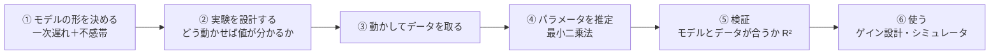
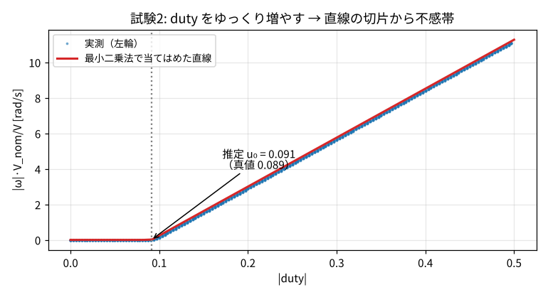
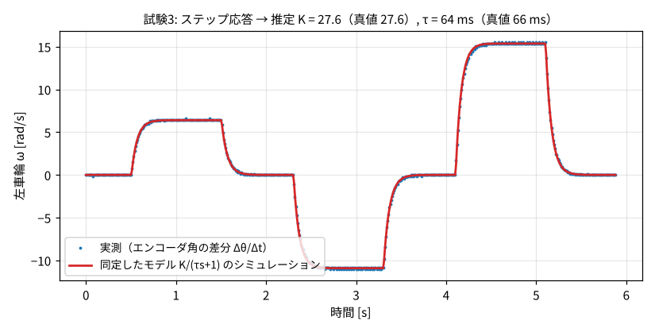

# 4. システム同定

## 4.1 システム同定とは

!!! tip "ひとことで"
    **実際に動かして測ったデータから、制御対象のモデル（式のパラメータ）を求めること。**
    「このモータは $K$ = 25.9、$\tau$ = 60 ms」のような数値を、実験で決める。

制御器の設計（ゲインの決め方）にはモデルが必要でした（[2 章](02_control_basics.md#23-モデルと伝達関数)）。
しかしデータシートには $K$ や $\tau$ は載っていないし、同じ部品でも **1 台ごとに 5〜15 % ばらつく** ので、実験で測る必要があります。

| 方法 | やり方 | 例 |
|---|---|---|
| **ホワイトボックス** | 物理法則から式を立て、部品の値を計算 | 慣性モーメント・抵抗・トルク定数から $\tau$ を計算 |
| **ブラックボックス** | 中身を考えず、入出力データだけから関係を当てはめる | 機械学習的な方法 |
| **グレーボックス**（COCO-LINK） | **式の形は物理から決め、パラメータの値だけをデータから求める** | 「一次遅れ + 不感帯」の形と決め、$K, \tau, u_0$ を推定 |

### 同定の流れ

### COCO-LINK でなぜ大事か

1. **ゲインを理論的に決められる**: 勘で調整せず、同定した $K, \tau$ から PI ゲインを計算（[4.8](#48-同定結果から制御器を設計するimc-法)）
2. **個体差を吸収**: ロボットごとに同定して、それぞれに合ったゲインを書き込む。全台が同じように動く → **隊形がそろう**
3. **シミュレータを実機に近づける**: 同定した値をシミュレータに入れれば、シミュレータでの結果が実機でも信用できる

## 4.2 推定するもの

| パラメータ | 意味 | 試験 |
|---|---|---|
| ジャイロバイアス $g_z^0$ | 止まっているのに出るジャイロの値（零点ずれ） | 1. 静止 |
| 不感帯 $u_0$（左右） | 回り始める duty | 2. duty ランプ |
| ゲイン $K$、時定数 $\tau$（左右） | モータの速さと反応の速さ | 3. duty ステップ |
| 車輪半径 $r$ | タイヤの実効的な半径 | 4. 直進 |
| トレッド幅 $b$ | 左右の車輪の実効的な間隔 | 5. その場旋回 |
| （評価のみ） | 速度制御の立ち上がり・オーバーシュート | 6. 検証 |

操作GUIの「システム同定」タブでボタンを押すと、1〜6 を自動で約 55 秒かけて行います。

## 4.3 道具 1：最小二乗法

!!! tip "ひとことで"
    **データ点に一番よく合う直線（式）を、「ずれの二乗の合計」が最小になるように選ぶ方法。**

測定データ $(x_i, y_i)$ に直線 $y = ax + c$ を当てはめたいとき、各点のずれ（**残差**）$y_i - (ax_i + c)$ の二乗和

$$
J(a, c) = \sum_i \bigl(y_i - (a x_i + c)\bigr)^2
$$

が最小になる $a, c$ を選びます。二乗するのは、正負のずれが打ち消し合わないようにし、かつ微分して解けるようにするためです。
$J$ を $a, c$ で偏微分して 0 とおくと連立方程式（**正規方程式**）が得られ、行列で書くと

$$
A = \begin{bmatrix} x_1 & 1\\ x_2 & 1\\ \vdots & \vdots \end{bmatrix},\quad
\boldsymbol\theta = \begin{bmatrix} a\\ c\end{bmatrix},\quad
\boldsymbol\theta = (A^\top A)^{-1}A^\top \boldsymbol y
$$

プログラムでは `numpy.linalg.lstsq` 1 行で解けます。**パラメータについて一次式** なら、どんなモデルでもこの形で解けるのがポイントです。

### 当てはまりの良さ：決定係数 R²

$$
R^2 = 1 - \frac{\sum (y_i - \hat y_i)^2}{\sum (y_i - \bar y)^2}
$$

モデルの予測 $\hat y_i$ がデータをどれだけ説明できているか。**1 に近いほど良い**（0.95 以上なら十分）。

## 4.4 試験 2：不感帯（duty ランプ）

その場旋回の形（左右逆回転）で、duty を 0 から 0.5 まで **8 秒かけてゆっくり** 増やします。
ゆっくりなら $\omega$ はほぼ定常値なので、モデルは $|\omega| = K(|u| - u_0)$ という **直線** になります。

- 回っている部分（$|\omega| > 1$ rad/s）に最小二乗法で直線を当てはめる
- **傾き** = $K$、**横軸との交点** = $u_0$（$u_0 = -$切片$/$傾き）
- 電池電圧の影響を取り除くため、$|\omega|$ に $V_{nom}/V$ を掛けてから当てはめる
- **補正**: ゆっくりでも $\omega$ は入力より $\tau$ だけ遅れるので、$u_0$ が「ランプの速さ × $\tau$」だけ大きく出る。これを差し引く

## 4.5 試験 3：モータ特性（duty ステップ）

duty を 0.3 → 0 → −0.45 → 0 → 0.6 → 0 と **ステップ状** に変え、応答の立ち上がり方から $K$ と $\tau$ を求めます。

### 方法 (a)：ARX モデル（線形最小二乗）

[2.11](02_control_basics.md#211-サンプリングと離散化) で見たとおり、一次遅れ系を離散化すると

$$
\omega_{k+1} = a\,\omega_k + b\,u_{\mathrm{eff},k}\qquad(a = e^{-T_s/\tau},\ b = (1-a)K)
$$

これは $a, b$ について一次式なので、最小二乗法で $a, b$ が求まり、$\tau = -T_s/\ln a$、$K = b/(1-a)$ と戻せます。
このような「過去の出力と入力から次の出力を予測する」モデルを **ARX モデル**（AutoRegressive with eXogenous input）といいます。

### 方法 (b)：非線形最小二乗法

ARX は簡単ですが、測定ノイズがあると推定値が偏ることが知られています。そこで ARX の結果を初期値にして、
**「$K, \tau$ を仮定してシミュレーションした応答」と「実測」のずれの二乗和** を直接最小化します（`scipy.optimize.least_squares`）。
$K, \tau$ について一次式ではないので、繰り返し計算で解きます（**非線形最小二乗法**）。図の赤線はこうして求めたモデルの応答で、実測とほぼ重なっています（$R^2 \approx 1.00$）。

## 4.6 試験 4・5：車輪半径とトレッド幅（ビジョンを使う）

- **直進**（前進 → 止まる → 後退 → 止まる）: カメラで測った移動距離 $d$ と、エンコーダで測った車輪の回転角 $\Delta\theta$ から
  $$r = \frac{d}{\Delta\theta}$$
- **その場旋回**（左回り → 止まる → 右回り → 止まる）: カメラ（またはジャイロ）で測った回転角 $\Delta\psi$ と、左右の車輪の回転角の差から
  $$b = \frac{r(\Delta\theta_R - \Delta\theta_L)}{\Delta\psi}$$
  （[3.2 の順運動学](03_robot_model.md#32-運動学車輪の速さとロボットの動きの関係) を時間で積分した式）

## 4.7 実験設計の工夫（ここが説明できると強い）

同定は「どう動かして、何を測るか」（**実験設計**）で精度が大きく変わります。COCO-LINK で実際に工夫した点です。

| 問題 | 原因 | 工夫 |
|---|---|---|
| カメラとロボットの時刻がずれている | 別々の機械で、通信遅れもある | **止まっている区間どうしを比べる**。止まっていれば時刻が多少ずれても位置は同じなので、**時刻合わせが不要** |
| Wi-Fi の到着時刻がばらつく | 無線の混雑 | 受信時刻ではなく、**ロボットがセンサを読んだ時刻（ロボットの時計）** で微分・積分する |
| $\tau$ が大きめに出る | ロボットが送る角速度はローパス（約 23 ms 遅れ）済み | 角速度ではなく **エンコーダ角の差分** を使う |
| $\tau$ が 2 割小さく出る | 送信 50 Hz・制御 100 Hz だと、1 サンプルの間に duty が 2 回変わることがあり、入力と応答の対応がずれる | **同定中だけ送信を 100 Hz に上げる**（終わったら戻す） |
| 不感帯が大きめに出る | ランプ中の応答の遅れ | ランプの速さ × $\tau$ を差し引く |
| 電池の減りで速さが変わる | 同じ duty でも電圧で回転数が変わる | モデルに $V/V_{nom}$ を入れ、電圧を記録して補正 |

!!! info "どうやって見つけたか"
    シミュレータの仮想ロボットには **答え（真値）** が隠してあるので、同定結果と比べれば誤差が分かります。
    「$\tau$ だけ 22 % 小さい」という結果から原因を調べ、サンプリングの問題だと突き止めました。
    **真値が分かるシミュレータで手法自体を検証してから実機に使う** のが、この設計の狙いです。

### シミュレータでの精度（個体差 ±15 % の仮想ロボット）

| パラメータ | 推定誤差 |
|---|---|
| ゲイン $K$ | 約 1 % |
| 時定数 $\tau$ | 約 3 % |
| 不感帯 $u_0$ | 約 2〜3 % |
| 車輪半径 $r$ | 約 0.2 % |
| トレッド幅 $b$ | 約 1 % |

（自動テスト `pc/tests/test_sysid.py` で毎回確認しています）

## 4.8 同定結果から制御器を設計する（IMC 法）

同定した $K, \tau$ から、車輪速度の PI ゲインを計算します。使うのは **IMC（内部モデル制御）法** の考え方です。

**狙い**: 閉ループ（目標 → 実際の速度）を、時定数 $\lambda$ の一次遅れ $\frac{1}{\lambda s + 1}$ にしたい。

制御対象 $G(s) = \frac{K}{\tau s+1}$ に対して、PI 制御器を

$$
C(s) = \frac{\tau s + 1}{K\lambda s} = \underbrace{\frac{\tau}{K\lambda}}_{k_p} + \underbrace{\frac{1}{K\lambda}}_{k_i}\cdot\frac{1}{s}
$$

と選ぶと、一巡伝達関数が $C(s)G(s) = \frac{1}{\lambda s}$（モータの遅れ $\tau s + 1$ が **打ち消される**）、閉ループは

$$
\frac{CG}{1 + CG} = \frac{1}{\lambda s + 1}
$$

と狙いどおりになります。つまり

$$
k_p = \frac{\tau}{K\lambda},\qquad k_i = \frac{1}{K\lambda},\qquad k_{ff} = \frac{1}{K},\qquad \tau_{ff} = \tau
$$

- **$\lambda$ が唯一の調整つまみ**。小さいほど速いが、ノイズやモデル誤差に弱くなる。COCO-LINK の既定は $\lambda$ = 50 ms
- フィードフォワード $k_{ff}, \tau_{ff}$ も同定値から決まる（[2.7](02_control_basics.md#27-フィードフォワードと-2-自由度制御)）
- 操作GUIの「ロボットへ書き込み」ボタンで、これらと $u_0, r, b$ をロボットに送る。最後に「検証」試験で改善を確認する

## 4.9 この章のまとめ

- **システム同定** = 実験データからモデルのパラメータを求めること。COCO-LINK は **グレーボックス**（形は物理、値はデータ）
- 道具は **最小二乗法**（ずれの二乗和を最小に）。線形なら ARX、非線形なら繰り返し計算
- 6 つの試験で ジャイロバイアス・不感帯・$K, \tau$・車輪半径・トレッド幅 を推定
- **実験設計の工夫**（静止区間の比較、ロボット時計、100 Hz、生のエンコーダ差分）で精度を上げた。真値を隠したシミュレータで検証済み
- 同定値から **IMC 法** で PI ゲインを計算してロボットへ書き込む

## 対応するコード・文書

| 内容 | 場所 |
|---|---|
| 試験の定義（どう動かすか） | [`pc/src/coco_link/sysid/experiments.py`](https://github.com/banbatakumi/COCO-LINK/blob/main/pc/src/coco_link/sysid/experiments.py) |
| 推定の計算（最小二乗・ARX・IMC） | [`pc/src/coco_link/sysid/estimators.py`](https://github.com/banbatakumi/COCO-LINK/blob/main/pc/src/coco_link/sysid/estimators.py) |
| 実行・記録・保存・書き込み | [`pc/src/coco_link/sysid/runner.py`](https://github.com/banbatakumi/COCO-LINK/blob/main/pc/src/coco_link/sysid/runner.py) |
| 精度のテスト | [`pc/tests/test_sysid.py`](https://github.com/banbatakumi/COCO-LINK/blob/main/pc/tests/test_sysid.py) |
| 技術的な詳細 | [設計文書: システム同定（技術）](../system_identification.md) |
