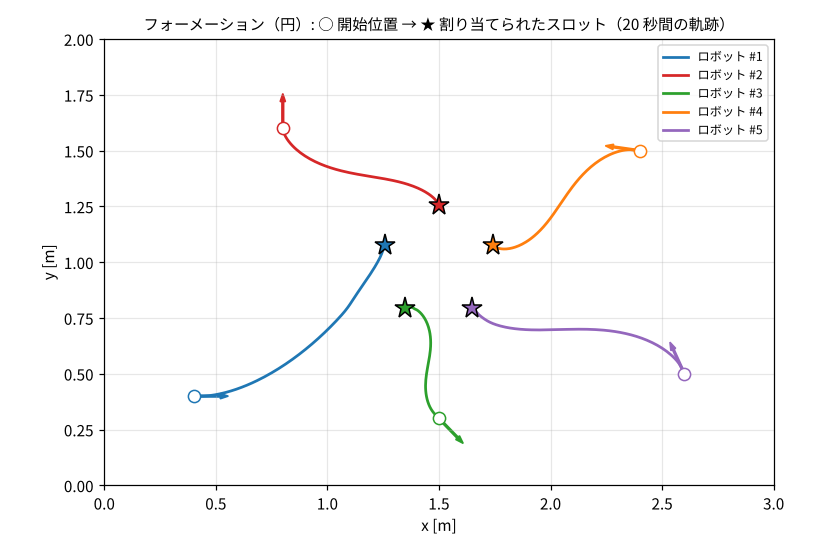
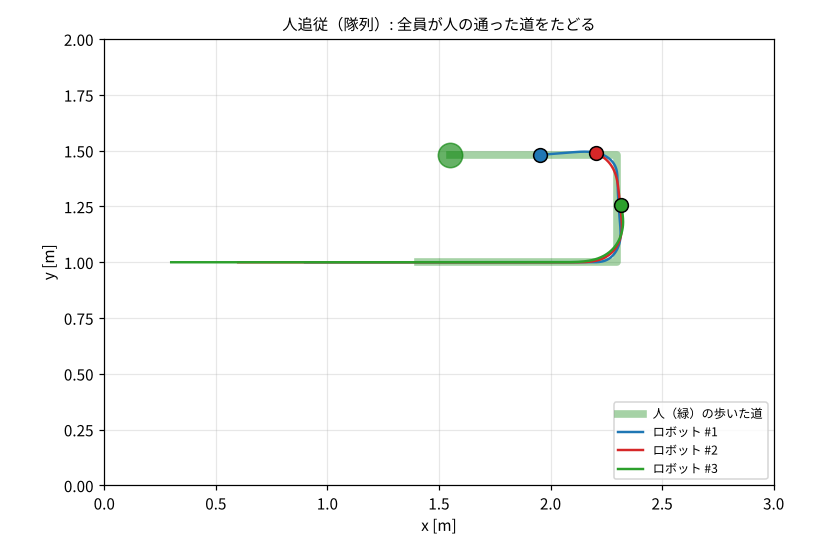

# 5. 上位制御：目標へ向かう・隊形・人追従・安全

上位制御は PC（操作GUI）で 1 秒に 20 回動き、**全ロボットの位置を見て、各ロボットの $(v, \omega)$ を決めます**。

## 5.1 目標の姿勢へ向かう：極座標フィードバック

!!! tip "ひとことで"
    「目標までの距離」「目標の方向へのずれ」「最終的な向きのずれ」の 3 つを見て、
    **距離に比例して進み、ずれに比例して曲がる**。横に動けないロボットでも、向きを変えながら目標の位置と向きにたどり着ける。

非ホロノミックなロボット（[3.3](03_robot_model.md#33-非ホロノミック拘束横には動けない)）を、目標の位置 **と向き** に止めるのは意外と難しい問題です。
そこで、誤差を極座標で表します。

| 記号 | 意味 |
|---|---|
| $\rho$ | 目標までの距離 |
| $\alpha$ | ロボットの正面から見た、目標の方向（どれだけ曲がれば目標を向くか） |
| $\beta$ | 目標に着いたとき、最終的な向きとのずれ |

$$
v = k_\rho\,\rho,\qquad \omega = k_\alpha\,\alpha + k_\beta\,\beta
$$

- $k_\rho > 0$, $k_\beta < 0$, $k_\alpha - k_\rho > 0$ を満たせば、目標の姿勢に収束することが証明されている（Siegwart らの教科書）
- COCO-LINK の値: $k_\rho = 1.2$, $k_\alpha = 4.0$, $k_\beta = -0.8$
- 実用上の工夫:
    - 目標が真後ろ寄り（$|\alpha| > 90°$）なら **バックで近づく**（U ターンしない）
    - 目標の方向を向くまでは前進を弱める（$v$ に $\cos^2\alpha$ を掛ける）
    - $v, \omega$ が上限を超えたら **同じ比率で** 縮める（曲がり具合を変えない）
    - 3 cm 以内に入ったらその場で向きだけ合わせる

## 5.2 フォーメーション

!!! tip "ひとことで"
    **隊形全体を 1 つの見えない板（仮想構造）とみなし**、板の上に「席（スロット）」を並べる。
    誰がどの席に行くかを **ハンガリアン法** で最適に決め、各ロボットは自分の席へ 5.1 の制御で向かう。

### 仮想構造法

- 隊形の中心の姿勢 $(x_c, y_c, \theta_c)$ と、隊形の形（円・V 字・横一列・縦一列・格子・ハート）から、各スロットの目標位置を計算
  $$p_i^* = \begin{bmatrix}x_c\\y_c\end{bmatrix} + R(\theta_c)\,o_i$$
  （$o_i$: 隊形の中での各席の位置、$R$: 回転行列）
- 中心を動かせば隊形ごと移動、$\theta_c$ を時間で変えれば **隊形ごと回転**（パフォーマンス）。操作GUIでフィールドをクリックすると中心が移動

### スロットの割り当て：ハンガリアン法

5 台のロボットを 5 つの席に割り当てる方法は $5! = 120$ 通り、10 台なら 362 万通りあります。
**移動距離の二乗の合計が最小** になる割り当てを、**ハンガリアン法** で効率よく（$O(n^3)$）求めます（`scipy.optimize.linear_sum_assignment`）。

!!! question "なぜ「距離の二乗」の合計なの？"
    二乗和を最小にすると、**ロボットの直線経路どうしが交差しない** 割り当てになります。
    もし 2 本の経路が交差していたら、行き先を入れ替えると二乗和が必ず小さくなるからです
    （複数ロボットの経路計画で知られる性質。Turpin らの CAPT アルゴリズムなど）。
    経路が交差しない → ぶつかりにくい、という利点があります。

- 割り当ては **ロボットの数や隊形が変わったときだけ** 計算し直す（毎回変えると行き先がころころ変わって振動する）

### ロボット同士の衝突回避

前方 ±60°・25 cm 以内に他のロボットがいたら、近いほど減速し、相手と反対側へ曲がります（簡易的な **ポテンシャル法**）。

### 演出

全員が席に着くと「完成」となり、LED がスロットごとの虹色に光ってチャイムが鳴ります。移動中は白く点滅します。

## 5.3 人追従（隊列）

!!! tip "ひとことで"
    **人の通った道（パンくず）を記録し、先頭ロボットはそれをたどる。2 台目は 1 台目の通った道を、3 台目は 2 台目の道を… たどる。**
    カルガモの親子のように、人が障害物を避けて歩けばロボットも同じ道で避けられる。

### 軌跡（パンくず）追従

- 人（ビジョンで緑の領域）の位置を 2 cm ごとに記録して「道」にする
- 先頭は人の道を、人から **道のりで 40 cm** 後ろを保って追う。後続は前のロボットの道を **25 cm** 間隔で追う
- 隊列の順番は開始時に人に近い順

### 速度：道のりの差に比例（P 制御）

前のもの（人 or 前のロボット）までの **道に沿った距離** $L$ と、保ちたい間隔 $d$ の差に比例して速度を決めます。

$$
v = \mathrm{clip}\bigl(k_v (L - d),\ 0,\ v_{max}\bigr)
$$

直線距離ではなく道のりを使うので、カーブで内側をショートカットしません。

### 操舵：Pure Pursuit（純追跡）

道の上で、自分から **一定の距離（注視距離 $L_d$, 12 cm）先の点** を目標にし、その点を通る円弧に乗るように曲がります。

$$
\kappa = \frac{2\sin\alpha}{L_d},\qquad \omega = v\,\kappa
$$

（$\kappa$: 曲率 = 円弧の半径の逆数、$\alpha$: その点の方向）

- $L_d$ を小さくすると道に正確に沿うがふらつきやすく、大きくすると滑らかだが内側を回る（**トレードオフ**）
- 自動車の自動運転やロボットの経路追従で広く使われる、シンプルで頑健な方法

## 5.4 安全機能

| 層 | 機能 | 内容 |
|---|---|---|
| ロボット | **ウォッチドッグ** | 指令が 300 ms 来なければ自分で止まる |
| ロボット | **E-STOP** | 非常停止。解除されるまで動かない |
| PC | **超音波による減速** | 進行方向の超音波距離が 30 cm 以下で減速、8 cm で停止 |
| PC | **ロボット同士の回避** | 5.2 のとおり |
| PC | **優先度の調停** | **E-STOP ＞ 手動操作 ＞ システム同定 ＞ モード** の順で指令を選ぶ |

超音波による減速は、進行方向の距離 $d$ に対して $v \leftarrow v \cdot \mathrm{clip}\left(\frac{d - 0.08}{0.30 - 0.08}, 0, 1\right)$ です。前進中は前、後退中は後ろのセンサを見ます。

!!! question "なぜ安全機能をロボット側と PC 側の両方に入れるの？"
    PC が固まる・Wi-Fi が切れる、といった **PC 側が機能しない故障** のときでも止まれるように、最後の砦はロボット側（ウォッチドッグ）に置いています。
    一方、周りの状況（他のロボットの位置など）を見た判断は全体が見える PC 側で行います。**多重の安全設計** です。

## 5.5 「世界の様子」をまとめる：WorldModel

上位制御は毎周期、ビジョン（位置）とテレメトリ（車輪の速さ・センサ）をまとめた **World**（世界のスナップショット）を作り、モードに渡します。
モードはこれだけを見て指令を返すので、**相手がシミュレータでも実機でも同じように動きます**。

## 5.6 カメラの遅れを補う（遅延補償と推測航法）

カメラの画像は撮影から届くまで 50〜100 ms 遅れます。0.2 m/s で動いていれば、その間に 1〜2 cm 進んでいます。

- **遅延補償**: 撮影時刻から現在までの間に進んだ分を、**エンコーダから求めた速度 $(v, \omega)$ で計算して足す**
  （ユニサイクルモデルを円弧として積分）
- **推測航法（デッドレコニング）**: カメラにロボットが一瞬映らなかった（人の陰など）ときも、0.5 秒までは車輪の回転から位置を推測し続ける。
  それ以上見えなければ「位置不明」として制御対象から外す（安全側）

!!! note "発展：カルマンフィルタ"
    より本格的には、カメラ・エンコーダ・ジャイロの値を、それぞれの誤差の大きさを考慮して最適に混ぜる **カルマンフィルタ（EKF）** を使います。
    今は「カメラを信じて、遅れと欠けだけ補う」簡単な方法にしています。今後の改善候補です。

## 5.7 この章のまとめ

- 目標の姿勢へは **極座標フィードバック**（距離・方向・向きのずれから $v, \omega$）
- フォーメーションは **仮想構造法** で席を作り、**ハンガリアン法** で割り当て（二乗和最小 → 経路が交差しない）
- 人追従は **軌跡（パンくず）追従** + **道のりの P 制御** + **Pure Pursuit**
- 安全は **ロボット側（ウォッチドッグ・E-STOP）と PC 側（超音波減速・回避・優先度）の多重構造**
- カメラの遅れは **車輪の速度で外挿** して補う

## 対応するコード・文書

| 内容 | 場所 |
|---|---|
| 極座標フィードバック・Kanayama 追従 | [`pc/src/coco_link/control/pose_tracking.py`](https://github.com/banbatakumi/COCO-LINK/blob/main/pc/src/coco_link/control/pose_tracking.py) |
| 隊形の生成・ハンガリアン法 | [`pc/src/coco_link/control/formation.py`](https://github.com/banbatakumi/COCO-LINK/blob/main/pc/src/coco_link/control/formation.py) |
| 軌跡記録・Pure Pursuit | [`pc/src/coco_link/control/path_follow.py`](https://github.com/banbatakumi/COCO-LINK/blob/main/pc/src/coco_link/control/path_follow.py) |
| 超音波減速・衝突回避 | [`pc/src/coco_link/control/safety.py`](https://github.com/banbatakumi/COCO-LINK/blob/main/pc/src/coco_link/control/safety.py) |
| フォーメーション / 人追従モード | [`pc/src/coco_link/modes/`](https://github.com/banbatakumi/COCO-LINK/tree/main/pc/src/coco_link/modes) |
| 遅延補償・推測航法 | [`pc/src/coco_link/fleet/world_model.py`](https://github.com/banbatakumi/COCO-LINK/blob/main/pc/src/coco_link/fleet/world_model.py) |
| 優先度の調停 | [`pc/src/coco_link/fleet/control_core.py`](https://github.com/banbatakumi/COCO-LINK/blob/main/pc/src/coco_link/fleet/control_core.py) |
| 数式の詳細 | [設計文書: 制御則](../control.md) |
