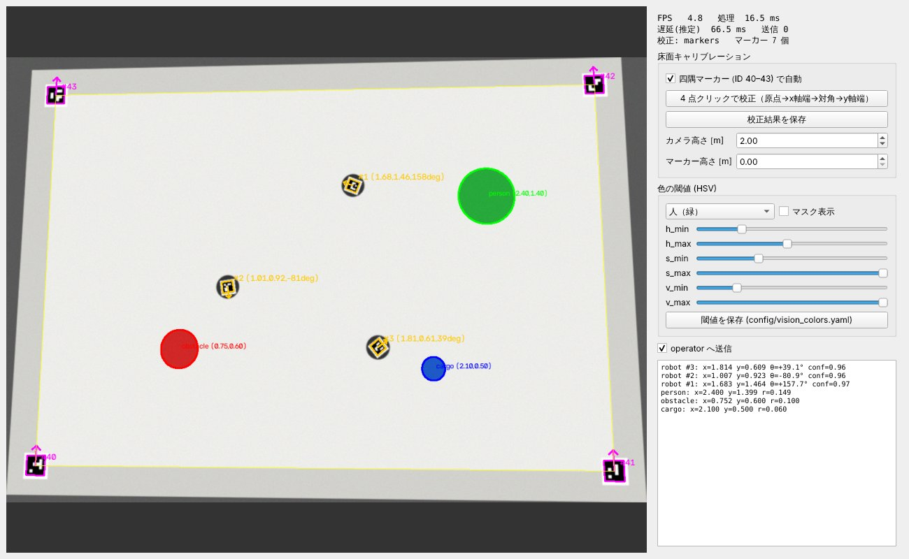
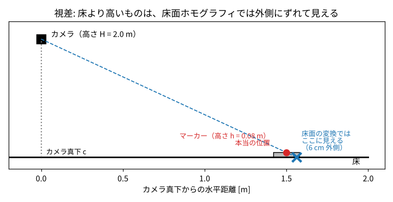

# 6. ビジョン：カメラでロボットの位置を測る

!!! tip "ひとことで"
    天井カメラで床を撮り、**画像の中の位置（ピクセル）を床の上の位置（メートル）に変換** する。
    ロボットは上面の **ArUco マーカー**（白黒の正方形の模様）で ID・位置・向きを、人・障害物・物資は **色** で見分ける。

## 6.1 なぜ外部カメラで位置を測るのか

ロボット自身もエンコーダ（車輪の回転）で自分の位置を計算できます（**オドメトリ**）。
しかし車輪の滑りや半径の誤差が **積み重なり、時間がたつほどずれていく** ので、長時間のフォーメーションには使えません。
天井カメラなら、誤差は積み重ならず、**全ロボットを同じ座標系で** 測れます。

## 6.2 画像の座標から床の座標へ：ホモグラフィ

カメラ画像の座標 $(u, v)$ [ピクセル] と、床の上の座標 $(x, y)$ [m] は、**床が平面なら 3×3 の行列 $H$ 1 つ** で変換できます。

$$
s\begin{bmatrix}x\\y\\1\end{bmatrix} = H\begin{bmatrix}u\\v\\1\end{bmatrix}
$$

この変換を **ホモグラフィ（射影変換）** といいます。カメラが少し斜めでも、遠近で台形にゆがんだ床を正しく長方形に戻せます。

- $H$ は 8 個の未知数を持つ（全体の倍率は自由なので 9−1）。1 組の点の対応で式が 2 本立つので、**4 点の対応** があれば求まる
- COCO-LINK では、フィールドの **四隅に ID 40〜43 の ArUco マーカー** を置き、その中心が「(0,0), (3,0), (3,2), (0,2) m」に対応することから **自動で $H$ を計算**（**キャリブレーション**）。毎フレーム計算し直すので、カメラが少し動いても追従する
- マーカーを置けないときは、画面上で四隅を 4 回クリックしても校正できる

## 6.3 視差補正

ホモグラフィは **床の高さ** の点にしか正しくありません。ロボットのマーカーは床から 8 cm ほど上にあるので、
カメラから見ると **実際より外側にずれて** 見えます（近くの物ほど大きく見えるのと同じ理由）。

相似な三角形から、カメラ真下の点 $c$ からの距離を $\frac{H - h}{H}$ 倍すれば正しい位置になります。

$$
p_{\mathrm{true}} = c + (p - c)\frac{H - h}{H}
$$

!!! example "どれくらいずれるか"
    カメラ高さ 2.0 m、マーカー高さ 0.08 m、カメラ真下から 1.5 m 離れた場所では、$1.5 \times 0.08/2.0 = 6$ cm もずれる。補正は必須。

## 6.4 ArUco マーカー

**ArUco** は、白黒の正方形パターンで ID を表すマーカーです（QR コードの簡単版）。OpenCV に検出機能が入っています。

- 4×4 ビットの模様で ID を表す（辞書 `DICT_4X4_50`、ID 0〜49）。**ID = ロボット番号**
- 誤り検出の仕組みがあり、似た模様と間違えにくい
- 4 つの角の位置が分かるので、**中心 → 位置**、**上辺の中点 − 下辺の中点 → 向き** が求まる。マーカーは上辺がロボットの前を向くように貼る
- 角の位置はサブピクセル（1 画素より細かい）精度で求めている

合成画像でのテストでは、**位置誤差 1 cm 以内、向き誤差 3° 以内** でした。

## 6.5 色で人・障害物・物資を見分ける：HSV 色空間

| 対象 | 色 | 想定 |
|---|---|---|
| 人 | 緑 | 緑のビブスや帽子を身につける |
| 障害物 | 赤 | 赤いコーンなど |
| 物資 | 青 | 青い箱 |

画像は普通 **RGB**（赤・緑・青の強さ）で表されますが、RGB は **明るさが変わると 3 つとも変わる** ので、照明が変わると同じ緑でも値が大きく変わります。
そこで **HSV 色空間** に変換します。

| 成分 | 意味 |
|---|---|
| **H**（色相, Hue） | 色の種類（赤 → 黄 → 緑 → 青 → 紫 → 赤 と一周する角度） |
| **S**（彩度, Saturation） | 色の鮮やかさ（灰色に近いと低い） |
| **V**（明度, Value） | 明るさ |

**色の種類は H だけで判断できる** ので、照明の変化に強くなります。処理の流れは:

1. HSV に変換し、H・S・V がそれぞれ範囲内の画素を白、それ以外を黒にする（**二値化 / 閾値処理**）
2. 小さなノイズを消す（**モルフォロジー演算**: オープニング・クロージング）
3. 白い領域の輪郭を求め、**床の上の面積**（ホモグラフィで変換して計算）が小さすぎるものは無視
4. 重心を床座標に変換して出力
5. **ロボット自身の周りは除外**（ロボットの LED が緑に光っても「人」と間違えないように）

!!! note "赤は H が一周の境目をまたぐ"
    赤は H = 0 付近なので、170〜179 と 0〜8 の 2 つの範囲を合わせて扱う。

閾値はビジョンの画面のスライダーで調整し、「マスク表示」で白黒の結果を見ながら合わせられます。

## 6.6 遅れ

撮影から送信まで、画像処理の時間とカメラ自体の遅れ（約 50 ms と仮定）があります。
この遅れの値も一緒に送り、上位制御が [遅延補償](05_upper_control.md#56-カメラの遅れを補う遅延補償と推測航法) に使います。

## 6.7 この章のまとめ

- 外部カメラなら誤差が積み重ならず、全ロボットを同じ座標で測れる
- **ホモグラフィ**: 床が平面なら 3×3 行列 1 つで画像 → 床座標。**4 点** で求まり、四隅のマーカーで自動校正
- マーカーは床より高いので **視差補正** が必要（相似三角形）
- ロボットは **ArUco**（ID・位置・向き）、人・障害物・物資は **HSV** の色相で判別

## 対応するコード・文書

| 内容 | 場所 |
|---|---|
| ホモグラフィ・視差補正 | [`pc/src/coco_link/vision/calibration.py`](https://github.com/banbatakumi/COCO-LINK/blob/main/pc/src/coco_link/vision/calibration.py) |
| ArUco 検出・姿勢 | [`pc/src/coco_link/vision/aruco_tracker.py`](https://github.com/banbatakumi/COCO-LINK/blob/main/pc/src/coco_link/vision/aruco_tracker.py) |
| 色の検出 | [`pc/src/coco_link/vision/color_detector.py`](https://github.com/banbatakumi/COCO-LINK/blob/main/pc/src/coco_link/vision/color_detector.py) |
| 処理全体 | [`pc/src/coco_link/vision/pipeline.py`](https://github.com/banbatakumi/COCO-LINK/blob/main/pc/src/coco_link/vision/pipeline.py) |
| 使い方・設定 | [設計文書: ビジョン（技術）](../vision.md) |
