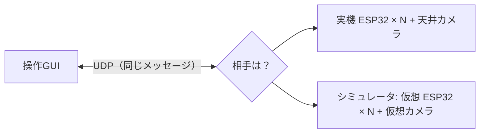

# 7. ソフトウェアの仕組み

制御の話ではなく、**プログラムとしてどう作ってあるか** の話です。プログラミングが苦手でも説明できるよう、用語から説明します。

## 7.1 使っている技術と選んだ理由

| 技術 | 何か | 選んだ理由 |
|---|---|---|
| **Python** | プログラミング言語 | 数値計算（NumPy/SciPy）・画像処理（OpenCV）が揃っていて、読み書きしやすい |
| **PySide6**（Qt） | 画面（GUI）を作る部品集 | Mac と Windows の両方で同じ見た目で動く |
| **OpenCV** | 画像処理ライブラリ | ArUco マーカー検出・ホモグラフィ・色処理が入っている |
| **ESP32** | ロボットのマイコン | Wi-Fi 内蔵、安価、2 系統の I2C など周辺機能が豊富 |
| **UDP + JSON** | 通信の方式とデータの書き方 | 速い・軽い・人間が読める（7.3） |
| **ROS は使わない** | ロボット用の定番ミドルウェア | プロジェクトの要件として使わない。代わりに通信の決まり（プロトコル）を自分たちで設計した |

## 7.2 プロセスとスレッド

- **プロセス**: 起動している 1 つのプログラム。COCO-LINK は **操作GUI・シミュレータ・ビジョン の 3 つのプロセス** に分かれ、別々に起動する。
  1 つが落ちても他は動き続け、別々の PC で動かすこともできる
- **スレッド**: 1 つのプロセスの中で **同時に進む処理の流れ**。操作GUIの中では
    - 画面を描くスレッド（30 回/秒）
    - **制御のスレッド**（20 回/秒）
    - 通信を受け取るスレッド
  
  が同時に動いています。**画面の描画が重くて固まっても、制御は止まらない** ように分けてあります

## 7.3 通信：UDP と JSON

### ネットワークの基本

- **IP アドレス**: ネットワーク上の機械の住所（例 `192.168.0.101`）
- **ポート番号**: 1 台の機械の中で、どのプログラム宛てかを区別する番号（部屋番号）。COCO-LINK では
  操作GUIが `50000`（ロボットから）と `50001`（ビジョンから）、ロボットが `50100` で受け取る

### UDP と TCP

| | **UDP**（COCO-LINK） | TCP |
|---|---|---|
| 届いたか確認 | しない（送りっぱなし） | する（届くまで再送） |
| 速さ・遅れ | 速い・遅れが小さい | 再送待ちで遅れることがある |
| 向いているもの | **最新の値だけが大事なもの**（位置・速度指令） | ファイルや Web ページ（全部届く必要がある） |

速度指令は 1 秒に 20 回送るので、1 回落ちても 50 ms 後に次が来ます。古い指令を再送されても意味がないので、UDP を選びました。
**万一ずっと届かなくなったら、ロボットのウォッチドッグが止める** ので安全です。

### JSON とメッセージ

**JSON** は、データを人間が読める文字で書く形式です。COCO-LINK のメッセージは 1 通 1 個の JSON です。

```json
{"v":1, "type":"cmd_vel", "src":"op", "seq":1024, "t_ms":53122, "vx":0.15, "wz":-0.3}
```

「プロトコル v1、種類は速度指令、送り主は操作GUI、通し番号 1024、時刻 53.122 秒、前進 0.15 m/s、右回り 0.3 rad/s」という意味です。
このような **通信の決まりごと** を **プロトコル** といい、`docs/protocol.md` に全部書いてあります。
**PC とロボット（ファームウェア）は別の言語・別の人が作るので、この文書が両者の「契約」** になります。

### ロボットの発見

ロボットは電源を入れると、1 秒ごとに「ロボット #3 です」（`hello`）と送ります。操作GUIはそれを受け取ると、
**送ってきた住所（IP アドレスとポート）を覚えて、そこに指令を送る** ようになります。だから IP アドレスを手で設定しなくても自動で見つかります。

## 7.4 シミュレータと実機を同じにする設計



- シミュレータの仮想ロボットは、ファームウェアの仕様書どおりに動く **Python 版のファームウェア（参照実装）** で動いている
- だから **操作GUIは相手が実機かシミュレータか区別しない**。シミュレータで動いたものは実機でも動く
- ファームウェアを作る人は、迷ったらこの Python 版と同じ動きにすればよい（仕様書 + 動く手本）

このように「中身が違っても、外から見た使い方（**インターフェース**）を同じにする」ことを **抽象化** といいます。

## 7.5 モードを追加しやすい作り（プラグイン）

フォーメーションや人追従などの動作（モード）は、決まった形のクラスを 1 ファイル書いて `modes/` フォルダに置くだけで、
**操作GUIの一覧に自動で出てきて、パラメータの入力欄も自動で作られます**。このような拡張の仕組みを **プラグイン** といいます。
今後の「協調物資運搬」や「経路計画走行」も、画面のプログラムを触らずに追加できます。

## 7.6 テストと CI

- **自動テスト**（pytest）: プログラムが正しく動くかを、プログラムで確認する仕組み。COCO-LINK には **127 個** のテストがある。例えば
    - 通信メッセージを送って受け取ると元に戻るか
    - ファームウェアの参照実装が、指令が途絶えたら 300 ms で止まるか
    - フォーメーションが 25 秒以内に完成するか（シミュレータを高速に回して確認）
    - システム同定がシミュレータの真値を数 % 以内で当てられるか
    - 合成したカメラ画像からロボットの位置を 1 cm 以内で求められるか
- **CI**（継続的インテグレーション, GitHub Actions）: GitHub にプログラムを送るたびに、**Mac・Windows・Linux で全テストを自動実行** する。
  誰かの変更で何かが壊れたらすぐ分かる

## 7.7 Git と GitHub

| 用語 | 意味 |
|---|---|
| **Git** | プログラムの変更履歴を管理する道具。いつ・誰が・何を変えたかが全部残り、昔の状態に戻せる |
| **コミット** | 変更を 1 つの区切りとして記録すること（「フォーメーションモードを追加」など） |
| **ブランチ** | 本流（`main`）から分かれた作業用の線。他の人の作業と干渉せずに開発できる |
| **プルリクエスト（PR）** | 「このブランチの変更を本流に入れてください」という依頼。CI の結果を確認してから **マージ**（取り込み）する |
| **GitHub** | Git のリポジトリを置いて共有する Web サービス。この資料のサイトも GitHub Pages で公開している |

COCO-LINK では機能ごとにブランチを分け（`feature/sysid` など）、コミットの書き方も統一しています（`docs/git_workflow.md`）。

## 7.8 データの記録：MCAP

操作GUIの「● MCAP 記録」を押すと、**すべての通信と制御の状態を時刻付きで 1 つのファイルに記録** します。

- **MCAP** はロボット分野でよく使われるログの形式。**Foxglove** というツールで開いてグラフにしたり再生したりできる
- CSV に変換して Excel でも解析できる
- 実験レポートで「隊形の誤差が何秒で何 cm 以下になったか」などを示すのに使える

## 7.9 この章のまとめ

- 3 つのプロセス（操作GUI・シミュレータ・ビジョン）に分け、制御は画面と別のスレッドで動かす
- 通信は **UDP + JSON**。最新値だけが大事なので再送しない UDP。通信の決まりは `protocol.md` が PC とロボットの契約
- **シミュレータと実機は同じインターフェース**。シミュレータの仮想ロボットはファームウェアの Python 版の手本
- モードは **プラグイン** で追加できる
- **自動テスト 127 個** を **CI** で Mac/Windows/Linux で毎回実行。Git で履歴とブランチを管理

## 対応するコード・文書

| 内容 | 場所 |
|---|---|
| メッセージの定義 | [`pc/src/coco_link/protocol/messages.py`](https://github.com/banbatakumi/COCO-LINK/blob/main/pc/src/coco_link/protocol/messages.py) |
| 通信の決まり | [設計文書: 通信プロトコル](../protocol.md) |
| モードの追加方法 | [設計文書: モードの追加](../adding_a_mode.md) |
| テスト | [`pc/tests/`](https://github.com/banbatakumi/COCO-LINK/tree/main/pc/tests) |
| CI | [`.github/workflows/ci.yml`](https://github.com/banbatakumi/COCO-LINK/blob/main/.github/workflows/ci.yml) |
| ログ | [設計文書: データロギング](../data_logging.md) |
| Git の運用 | [設計文書: Git 運用](../git_workflow.md) |
